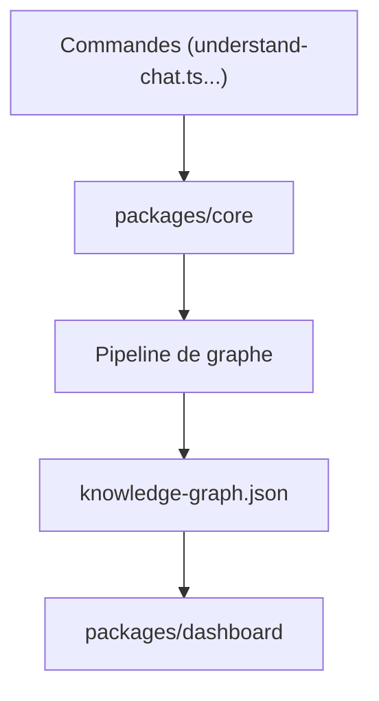

# Lum1104/Understand-Anything

> A code agent plugin that transforms a repository or wiki into an interactive knowledge graph.

## The problem
To face a codebase of 200,000 lines without knowing where to begin.

## What it actually does
`/understand` initiates a multi-agent pipeline (scanning, file analysis, architectural layers, guided tours, review) that combines Tree-sitter (a deterministic parser) and LLM. It generates a JSON graph (`.ua/knowledge-graph.json`) which is read by a read-only React dashboard. Additional commands: chat, diff, explain, onboard, domain, knowledge.

## How it is wired


## Trying it
```bash
/plugin marketplace add Egonex-AI/Understand-Anything
/plugin install understand-anything
/understand
/understand-dashboard
```

## Cost and gotchas
The first analysis consumes a large number of tokens on a large project (as noted in the README); a local model is possible. Subsequent analyses are incremental. The graph can exceed 10 MB: git-lfs is recommended.

## What it is not
Not a tool without an LLM: only the standalone viewer functions without a key. No central server: everything is local.

## Alternatives
No alternative is specified in the README file.

## For you
Things to watch out for: useful for claiming a large deposit, but involves token costs and a relatively recent deposit (created in March 2026). This deposit also appears under the Egonex-AI organization, with the same content.
