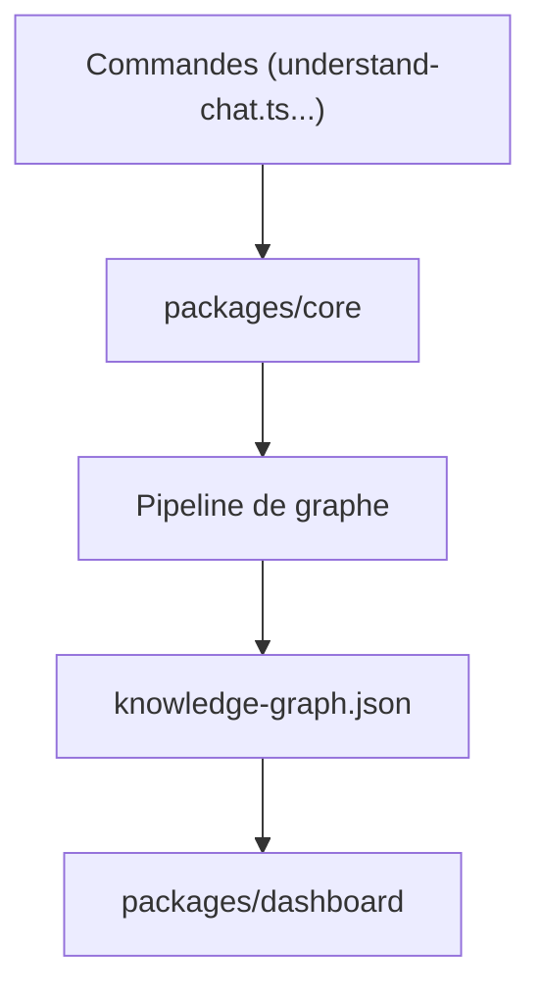

# Lum1104/Understand-Anything

> Plugin d'agent de code qui transforme un dépôt ou un wiki en graphe de connaissances interactif.

## Le problème
Arriver sur un code de 200 000 lignes sans savoir où commencer.

## Ce que ça fait vraiment
`/understand` lance un pipeline multi-agents (scanner, analyse de fichiers, couches d'architecture, parcours guidés, relecture) mêlant Tree-sitter déterministe et LLM. Il écrit un graphe JSON (`.ua/knowledge-graph.json`) que lit un dashboard React en lecture seule. Commandes annexes : chat, diff, explain, onboard, domain, knowledge.

## Comment c'est branché


## Essayer
```bash
/plugin marketplace add Egonex-AI/Understand-Anything
/plugin install understand-anything
/understand
/understand-dashboard
```

## Coût et pièges
La première analyse consomme beaucoup de tokens sur un gros projet (avertissement du README) ; un modèle local est possible. Les analyses suivantes sont incrémentales. Le graphe peut dépasser 10 Mo : git-lfs conseillé.

## Ce que ce n'est pas
Pas un outil sans LLM : seul le visualiseur autonome fonctionne sans clé. Pas de serveur central : tout est local.

## Alternatives
Aucune alternative nommée dans le README.

## Pour toi
À surveiller : utile pour s'approprier un gros dépôt, mais coût en tokens et dépôt récent (créé en mars 2026). Ce dépôt apparaît aussi sous l'organisation Egonex-AI avec le même contenu.

