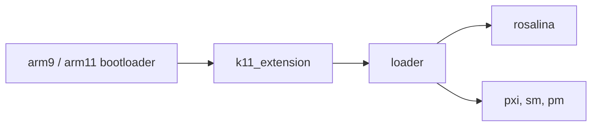

# LumaTeam/Luma3DS

> A custom firmware for Nintendo 3DS consoles, for anyone who wants homebrew and modding.

## The problem
The 3DS's official system limits homebrew, game modding and debugging.

## What it actually does
It patches and reimplements parts of the system: a settings menu at boot, a payload loader, the Rosalina overlay menu (screenshots, screen filters, cheats), 3GX game plugins, resource redirection (LayeredFS) and a GDB server. It builds into a single `boot.firm` file to copy onto the SD card.

## How it is wired

## Trying it
The README describes installation without commands: install boot9strap, then extract the archive of the latest release at the root of the SD card. To build: `sudo dkp-pacman -S 3ds-dev --needed`.

## Cost and gotchas
Free. You need boot9strap, a 3DS and an SD card; building requires devkitARM, libctru, makerom and firmtool. GPLv3 license (GDB stub and some modules under MIT). Wiki judged very outdated.

## What it is not
Not PC software. The cheat engine crashes with some games (Pokémon).

## Alternatives
No alternative named in the README.

## For you
Ignore: console firmware, unrelated to data, AI or MLOps.
