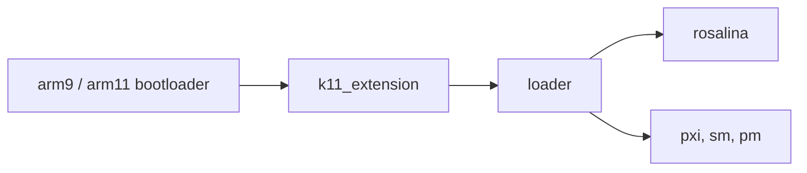

# LumaTeam/Luma3DS

> Un firmware personnalisé pour consoles Nintendo 3DS, pour qui veut du homebrew et du modding.

## Le problème
Le système officiel de la 3DS limite homebrew, modding de jeux et débogage.

## Ce que ça fait vraiment
Il patche et réimplémente des parties du système : menu de réglages au démarrage, chargeur de payloads, menu superposé Rosalina (captures, filtres d'écran, cheats), plugins de jeux 3GX, redirection de ressources (LayeredFS) et serveur GDB. Il se compile en un seul fichier `boot.firm` à copier sur la carte SD.

## Comment c'est branché

## Essayer
Le README décrit l'installation sans commande : installer boot9strap, puis extraire l'archive de la dernière version à la racine de la carte SD. Pour compiler : `sudo dkp-pacman -S 3ds-dev --needed`.

## Coût et pièges
Gratuit. Il faut boot9strap, une 3DS et une carte SD ; la compilation demande devkitARM, libctru, makerom et firmtool. Licence GPLv3 (stub GDB et certains modules en MIT). Wiki jugé très dépassé.

## Ce que ce n'est pas
Pas un logiciel pour PC. Le moteur de cheats plante avec certains jeux (Pokémon).

## Alternatives
Aucune alternative nommée dans le README.

## Pour toi
À ignorer : du firmware de console, sans rapport avec la data, l'IA ou le MLOps.

