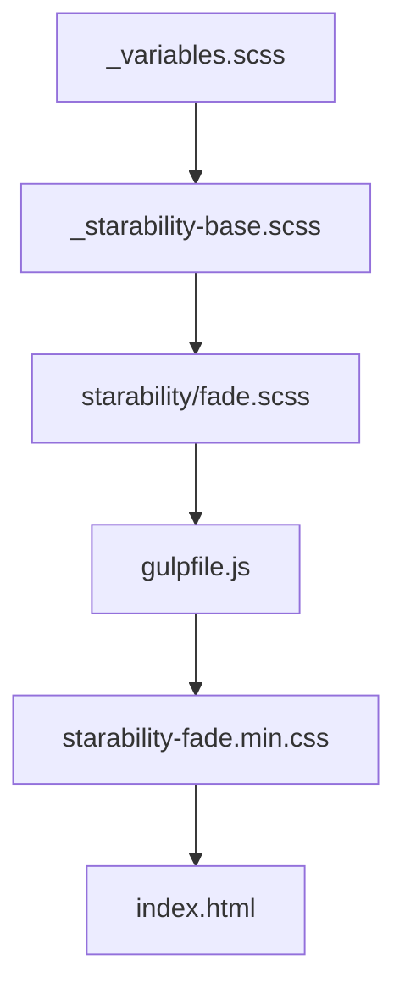

# LunarLogic/starability

> Accessible star rating in pure HTML and CSS, with animations, no JavaScript.

## The problem
Rating widgets are often inaccessible to keyboards and screen readers.

## What it actually does
A styled fieldset of radio buttons, with nine animations (basic, slot, grow, fade, heart, coinFlip...), keyboard-navigable, no dependencies. Also displays a static result via data-rating. Customizable in SASS. Submits nothing: sending the data is up to your code.

## How it is wired


## Trying it
```html
<link rel="stylesheet" type="text/css" href="css/starability-fade.min.css"/>
<fieldset class="starability-fade">
```

## Cost and gotchas
Free. Last push in February 2023. Half stars are not officially supported. Distinct ids are required for each widget.

## What it is not
Not a complete rating system: no storage and no submission.

## Alternatives
No alternative named in the README; the technique comes from Lea Verou.

## For you
Ignore: a front-end component for a website, unrelated to data/AI.
