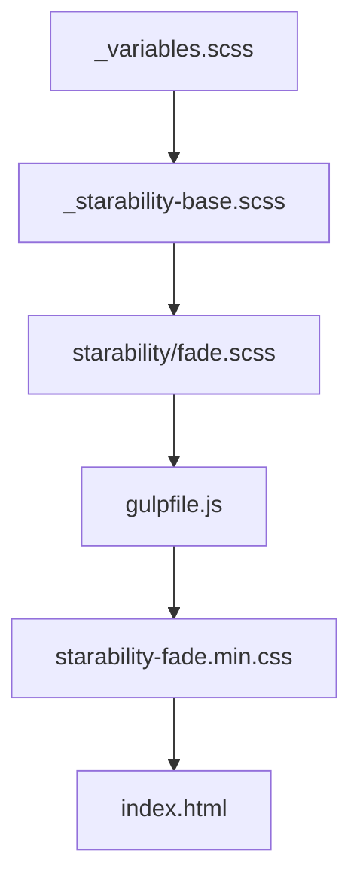

# LunarLogic/starability

> Notation par étoiles accessible, en HTML et CSS pur, avec animations, sans JavaScript.

## Le problème
Les widgets de notation sont souvent inaccessibles au clavier et aux lecteurs d'écran.

## Ce que ça fait vraiment
Un fieldset de boutons radio stylé, avec neuf animations (basic, slot, grow, fade, heart, coinFlip...), navigable au clavier, sans dépendance. Affiche aussi un résultat statique via data-rating. Personnalisable en SASS. Ne soumet rien : l'envoi des données reste à ton code.

## Comment c'est branché


## Essayer
```html
<link rel="stylesheet" type="text/css" href="css/starability-fade.min.css"/>
<fieldset class="starability-fade">
```

## Coût et pièges
Gratuit. Dernier push en février 2023. Les demi-étoiles ne sont pas gérées officiellement. Des ids différents sont nécessaires pour chaque widget.

## Ce que ce n'est pas
Pas un système de notes complet : pas de stockage ni d'envoi.

## Alternatives
Aucune alternative nommée dans le README ; la technique vient de Lea Verou.

## Pour toi
Ignorer : composant front pour un site web, sans lien avec data/IA.

