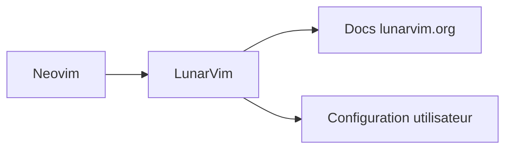

# LunarVim/LunarVim

> IDE layer for Neovim with sensible defaults, community-driven and free, for Neovim users.

## The problem
Setting up Neovim as a full development environment takes a lot of manual configuration.

## What it actually does
Minimal sheet: the README contains only a one-sentence description and links (installation, configuration, troubleshooting, contributing) to the lunarvim.org site. No detail on how it works appears there.

## How it is wired
Not documented; only the trio Neovim, LunarVim, documentation is established.

## Trying it
No command documented in the README; installation is at https://www.lunarvim.org/docs/installation.

## Cost and gotchas
Free, GPL-3.0. Last push on 2025-06-05, more than a year ago: maintenance needs checking.

## What it is not
Not a standalone editor: it relies on Neovim. The README states neither the prerequisites nor the features provided.

## Alternatives
None named in the README.

## For you
Ignore: editor configuration unrelated to data/AI work, and no commit for over a year.
