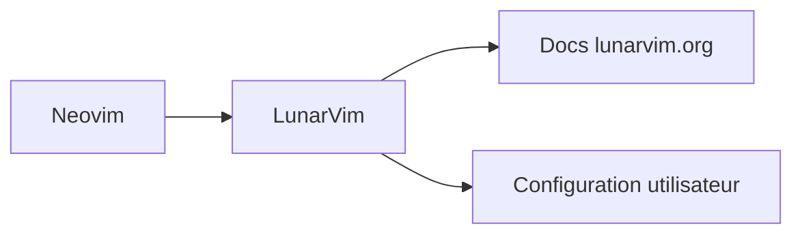

# LunarVim/LunarVim

> Couche IDE pour Neovim avec réglages par défaut, communautaire et gratuite, pour utilisateurs de Neovim.

## Le problème
Configurer Neovim en environnement de développement complet demande beaucoup de réglages manuels.

## Ce que ça fait vraiment
Fiche minimale : le README ne contient qu'une phrase de description et des liens (installation, configuration, dépannage, contribution) vers le site lunarvim.org. Aucun détail de fonctionnement n'y figure.

## Comment c'est branché
Non documenté ; seul le trio Neovim, LunarVim, documentation est établi.

## Essayer
Aucune commande documentée dans le README ; l'installation est sur https://www.lunarvim.org/docs/installation.

## Coût et pièges
Gratuit, GPL-3.0. Dernier push le 2025-06-05, soit plus d'un an : la maintenance est à vérifier.

## Ce que ce n'est pas
Pas un éditeur autonome : il s'appuie sur Neovim. Le README ne dit ni les prérequis ni les fonctions fournies.

## Alternatives
Aucune nommée dans le README.

## Pour toi
Ignorer : configuration d'éditeur sans rapport avec le travail data/IA, et sans commit depuis plus d'un an.

