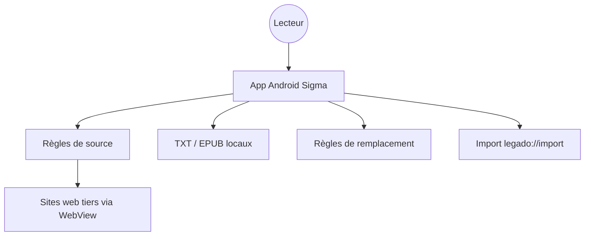

# Luoyacheng/legado-E

> Android app for reading online and local books, derived from Legado, with customizable sources.

## The problem
Reading web novels from various sites without a dedicated app for each site: you need a reader where the user defines where and how to fetch the content.

## What it actually does
The "阅读Sigma" reader extends Legado. It is driven by book sources defined by rules (search, discovery, subscriptions), reads local TXT and EPUB files, customizes the display and cleans up content with replacement rules. Its own additions: audio with lyrics, video with scrolling comments, an improved source editor. A Web API and Content Provider allow import via `legado://import/…` URLs.

## How it is wired
Simplified diagram based on the fiche, no diagram provided.

## Trying it
No command documented. Described path: install the APK (a beta that overwrites Legado, or a plus version with a new package name), then import sources manually via `legado://import/{path}?src={url}`.

## Cost and gotchas
Free, no ads. The software provides no content: you must add the sources yourself. Interface and documentation in Chinese only.

## What it is not
It is not a book catalog. The README disclaims any responsibility for content fetched through third-party sources, whose legality is not guaranteed. GPL-3.0 license (copyleft).

## Alternatives
No alternative named in the README.

## For you
Ignore: an Android reading app in Chinese, unrelated to data, AI or MLOps, and with legal risk on the third-party sources side.
