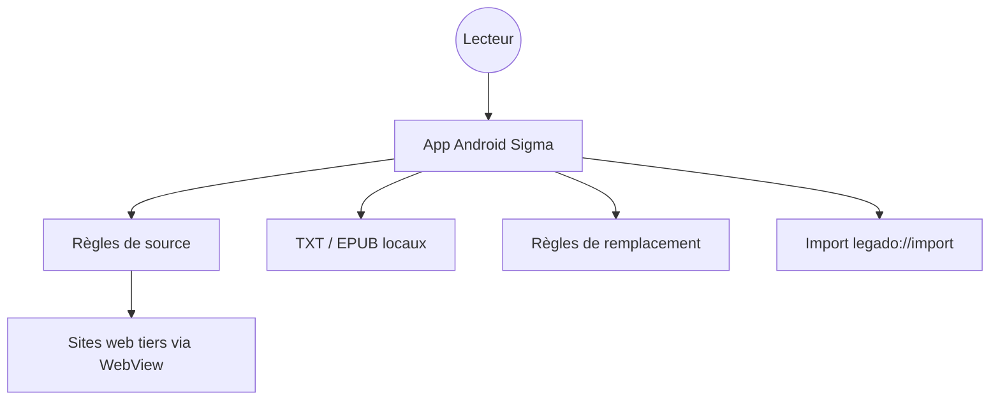

# Luoyacheng/legado-E

> Application Android de lecture de livres en ligne et locaux, dérivée de Legado, avec sources personnalisables.

## Le problème
Lire des romans web depuis des sites variés sans app dédiée par site : il faut un lecteur dont l'utilisateur définit lui-même où et comment récupérer le contenu.

## Ce que ça fait vraiment
Le lecteur « 阅读Sigma » prolonge Legado. Il se pilote par des sources de livres définies par règles (recherche, découverte, abonnements), lit des fichiers TXT et EPUB locaux, personnalise l'affichage et nettoie le contenu par règles de remplacement. Ajouts propres : audio avec paroles, vidéo avec commentaires défilants, éditeur de sources amélioré. Une API Web et Content Provider permet l'import par URL `legado://import/…`.

## Comment c'est branché
Schéma simplifié d'après la fiche, sans diagramme fourni.

## Essayer
Aucune commande documentée. Parcours décrit : installer l'APK (bêta qui écrase Legado, ou version plus avec un nouveau nom de paquet), puis importer des sources manuellement via `legado://import/{path}?src={url}`.

## Coût et pièges
Gratuit, sans publicité. Le logiciel ne fournit aucun contenu : il faut ajouter soi-même les sources. Interface et documentation en chinois uniquement.

## Ce que ce n'est pas
Ce n'est pas un catalogue de livres. Le README décline toute responsabilité sur les contenus récupérés via les sources tierces, dont la légalité n'est pas garantie. Licence GPL-3.0 (copyleft).

## Alternatives
Aucune alternative nommée dans le README.

## Pour toi
À ignorer : une app Android de lecture en chinois, sans lien avec data, IA ou MLOps, et avec un risque juridique côté sources tierces.

