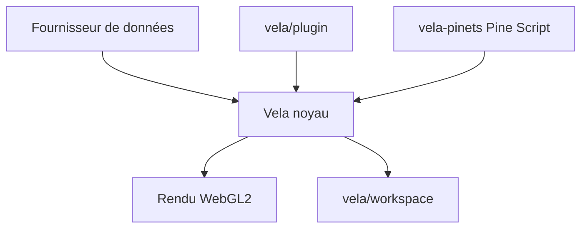

# LuxAlgo/Vela

> TypeScript library for WebGL2 financial charts, with a headless core and an optional full application.

## The problem
Embedding an interactive trading chart in a web page forces you into closed or heavy libraries.

## What it actually does
A chart core you drive from code, a WebGL2 rendering engine with canvas2d fallback, and a full workspace (chart grid, symbol search, drawings, persistent state). More than 70 indicators are built in. Data providers Binance, Coinbase and Hyperliquid, or your own bars. A plugin SDK adds chart types and layers.

## How it is wired
Simplified diagram based on the fiche, no diagram provided.



## Trying it
```bash
npm install @luxalgo/vela
npm install
npm run playground   # vite playground on http://localhost:5190
npm test
```

## Cost and gotchas
Free. The Pine Script module `@luxalgo/vela-pinets` is under AGPL-3.0, while Vela is under Apache-2.0. The data providers call public market APIs. The project dates from July 2026.

## What it is not
Not a backtesting engine nor a data source: it displays charts. It ships no script engine by default.

## Alternatives
No alternative named in the README.

## For you
Worth watching: useful for a financial time-series dashboard, but young and trading-focused.
