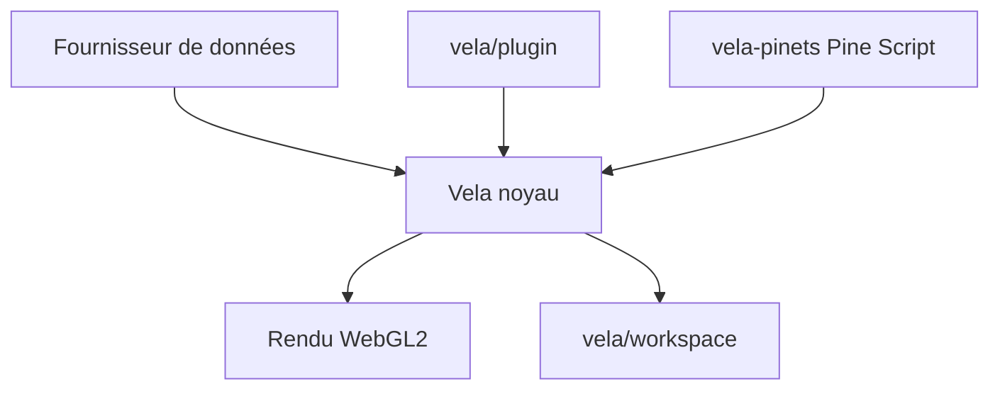

# LuxAlgo/Vela

> Bibliothèque TypeScript de graphiques financiers WebGL2, avec noyau sans interface et application complète optionnelle.

## Le problème
Intégrer un graphique de trading interactif dans une page web impose des bibliothèques fermées ou lourdes.

## Ce que ça fait vraiment
Un noyau de graphique pilotable par code, un moteur de rendu WebGL2 avec repli canvas2d, et un espace de travail complet (grille de graphiques, recherche de symbole, dessins, état persistant). Plus de 70 indicateurs sont intégrés. Fournisseurs de données Binance, Coinbase et Hyperliquid, ou tes propres barres. Un SDK de plugins ajoute types de graphique et couches.

## Comment c'est branché
Schéma simplifié d'après la fiche, sans diagramme fourni.



## Essayer
```bash
npm install @luxalgo/vela
npm install
npm run playground   # vite playground on http://localhost:5190
npm test
```

## Coût et pièges
Gratuit. Le module Pine Script `@luxalgo/vela-pinets` est sous AGPL-3.0, alors que Vela est en Apache-2.0. Les fournisseurs de données appellent des API publiques de marché. Le projet date de juillet 2026.

## Ce que ce n'est pas
Pas un moteur de backtest ni une source de données : il affiche des graphiques. Il ne livre aucun moteur de script par défaut.

## Alternatives
Aucune alternative nommée dans le README.

## Pour toi
À surveiller : utile pour un tableau de bord de séries temporelles financières, mais jeune et centré sur le trading.

