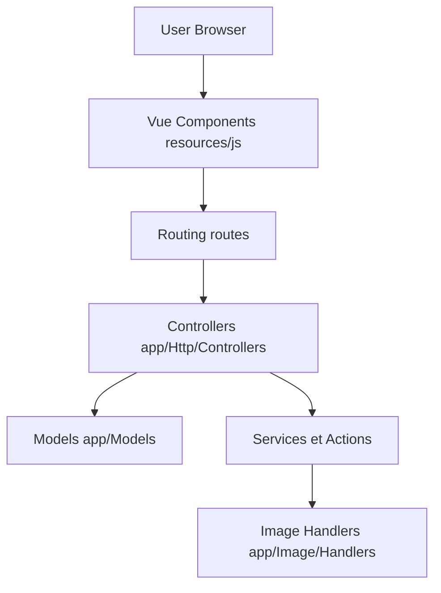

# LycheeOrg/Lychee

> Self-hosted photo gallery to upload, organize and share your photos from your own server.

## The problem
Online photo services raise privacy and cost concerns, while you want a space of your own.

## What it actually does
Laravel application with a Vue interface: upload, albums, sharing, smart albums, image processing (ImageMagick or GD), background tasks via a queue, versioned API, MySQL/MariaDB, PostgreSQL or SQLite database. A Supporter edition adds paid features.

## How it is wired
Diagram based on the one provided.



## Trying it
```bash
curl -O https://raw.githubusercontent.com/LycheeOrg/Lychee/master/docker-compose.minimal.yaml
docker compose -f docker-compose.minimal.yaml up -d
```

## Cost and gotchas
Free in the open edition; a Supporter edition exists. Docker and a database required. Version 7.0 changes the Docker image: read the upgrade guide. Building from source: PHP 8.4+, Composer, npm.

## What it is not
Not an image analysis or AI sorting tool: the README only covers management and sharing. Not a hosted service.

## Alternatives
No alternative named in the README.

## For you
Ignore for your work: it is a personal gallery. It may suit a home server, not a data pipeline.
