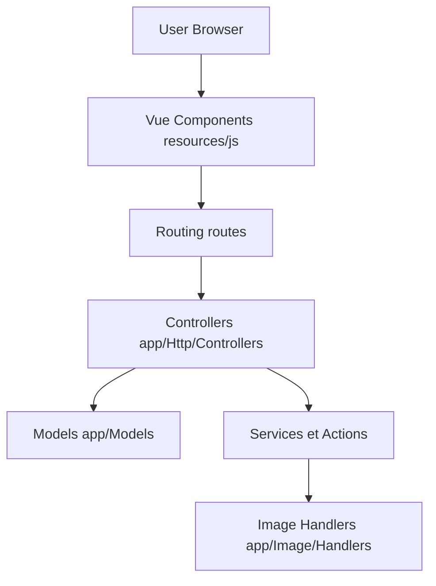

# LycheeOrg/Lychee

> Galerie photo auto-hébergée pour téléverser, organiser et partager ses photos depuis son serveur.

## Le problème
Les services de photos en ligne posent des questions de confidentialité et de coût, alors qu'on veut un espace à soi.

## Ce que ça fait vraiment
Application Laravel avec interface Vue : envoi, albums, partage, albums intelligents, traitement d'images (ImageMagick ou GD), tâches en arrière-plan via une file, API versionnée, base MySQL/MariaDB, PostgreSQL ou SQLite. Une édition Supporter ajoute des fonctions payantes.

## Comment c'est branché
Schéma d'après le diagramme fourni.



## Essayer
```bash
curl -O https://raw.githubusercontent.com/LycheeOrg/Lychee/master/docker-compose.minimal.yaml
docker compose -f docker-compose.minimal.yaml up -d
```

## Coût et pièges
Gratuit en édition libre ; une édition Supporter existe. Docker et une base de données requis. La version 7.0 change l'image Docker : lire le guide de mise à niveau. Compilation depuis les sources : PHP 8.4+, Composer, npm.

## Ce que ce n'est pas
Pas un outil d'analyse d'images ni de tri par IA : le README ne parle que de gestion et de partage. Pas un service hébergé.

## Alternatives
Aucune alternative nommée dans le README.

## Pour toi
À ignorer pour ton travail : c'est une galerie perso. Elle peut convenir à un serveur maison, pas à un pipeline data.

