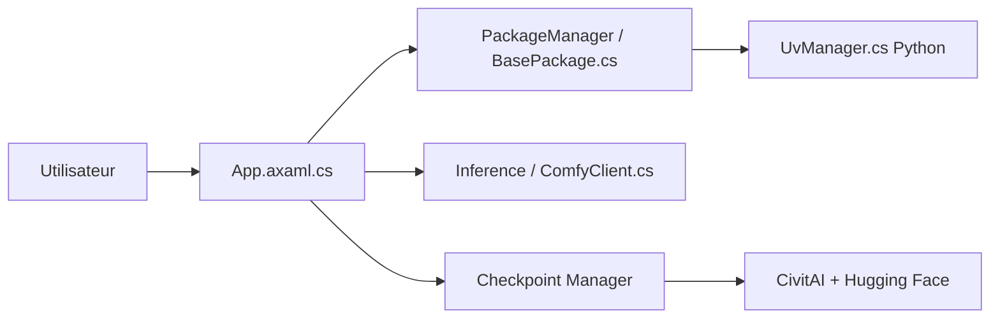

# LykosAI/StabilityMatrix

> Package manager and inference interface for Stable Diffusion, for people who generate images locally.

## The problem
Installing ComfyUI, Forge, Fooocus or Kohya separately, with their Python and Git dependencies, quickly becomes unmanageable. Models get duplicated from one tool to another.

## What it actually does
Desktop application that installs and updates, in one click, about twenty generation interfaces (reForge, Forge, A1111, SD.Next, ComfyUI, SwarmUI, InvokeAI, Kohya, OneTrainer, FluxGym...). It bundles Git and Python, shares a models folder across packages and imports from CivitAI and Hugging Face. It adds "Inference", a built-in interface that drives ComfyUI (`.smproj` files).

## How it is wired

## Trying it
No command documented. The README points to the Releases page: Windows x64 zip, Linux zip, AUR, macOS arm64 dmg.

## Cost and gotchas
Free, but the installed packages need a GPU to be useful and a lot of disk space for models. AGPL-3.0 license: sharing obligations if you modify and serve the software.

## What it is not
Not a generation engine: it orchestrates third-party projects it depends on. The README documents no command line or API.

## Alternatives
- ComfyUI: the engine itself, if you only need one tool.
- InvokeAI: unified interface with its own installation.

## For you
Worth watching: useful if you do local image experimentation on a GPU, of no interest for server MLOps, and the AGPL weighs if you want to reuse it.
