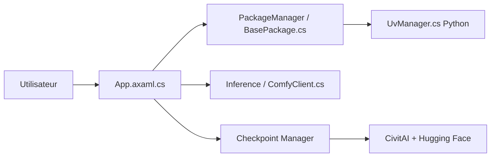

# LykosAI/StabilityMatrix

> Gestionnaire de paquets et interface d'inférence pour Stable Diffusion, pour qui génère des images en local.

## Le problème
Installer ComfyUI, Forge, Fooocus ou Kohya séparément, avec leurs dépendances Python et Git, devient vite ingérable. Les modèles se dupliquent d'un outil à l'autre.

## Ce que ça fait vraiment
Application de bureau qui installe et met à jour, en un clic, une vingtaine d'interfaces de génération (reForge, Forge, A1111, SD.Next, ComfyUI, SwarmUI, InvokeAI, Kohya, OneTrainer, FluxGym…). Elle embarque Git et Python, partage un dossier de modèles entre paquets et importe depuis CivitAI et Hugging Face. Elle ajoute « Inference », une interface intégrée qui pilote ComfyUI (fichiers `.smproj`).

## Comment c'est branché

## Essayer
Aucune commande documentée. Le README renvoie vers la page Releases : zip Windows x64, zip Linux, AUR, dmg macOS arm64.

## Coût et pièges
Gratuit, mais les paquets installés demandent un GPU pour être utiles et beaucoup d'espace disque pour les modèles. Licence AGPL-3.0 : obligations de partage si tu modifies et sers le logiciel.

## Ce que ce n'est pas
Ce n'est pas un moteur de génération : il orchestre des projets tiers dont il dépend. Le README ne documente aucune commande en ligne ni API.

## Alternatives
- ComfyUI : le moteur lui-même, si tu n'as besoin que d'un outil.
- InvokeAI : interface unifiée avec sa propre installation.

## Pour toi
À surveiller : utile si tu fais de l'expérimentation image locale sur GPU, sans intérêt pour du MLOps serveur, et l'AGPL pèse si tu veux le réutiliser.

