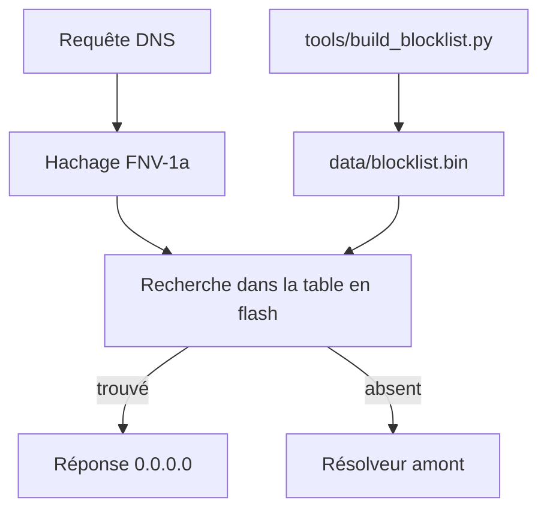

# M-Abozaid/esp32-c3-adblock

> Pi-hole-style DNS ad blocker that fits on a two-dollar ESP32-C3.

## The problem
A conventional DNS blocker keeps the blocklist in RAM, which requires PSRAM or a dedicated machine.

## What it actually does
Stores domains as 40-bit hashes sorted in flash and looks them up by binary search: 140,000 domains fit in about 0.7 MB of flash and about 50 KB of RAM. A blocked domain receives `0.0.0.0`, otherwise the request goes to the upstream resolver (Quad9 by default). Web dashboard, WiFi updates (OTA) and a captive configuration portal. Also builds for ESP32 and ESP8266.

## How it is wired
Simplified diagram based on the sheet, no diagram provided.


## Trying it
```bash
cp src/secrets.example.h src/secrets.h
python3 tools/build_blocklist.py data/blocklist.bin
pio run -t upload
pio run -t uploadfs
dig @<c3-ip> doubleclick.net
```

## Cost and gotchas
About two dollars of hardware, plus a stable USB power supply. The `WEB_USER`, `WEB_PASS` and `OTA_PASS` credentials in `secrets.h` are mandatory. A recent PlatformIO is required.

## What it is not
No HTTPS on the dashboard: plain HTTP with basic authentication only protects on the local network. No DNS cache or built-in DHCP. It does not handle IPv6.

## Alternatives
- s60sc/ESP32_AdBlocker: the starting idea, but it loads the list into RAM (cited in the README).

## For you
Ignore: a network tinkering project unrelated to data or AI, even though the flash hashing trick is elegant.
