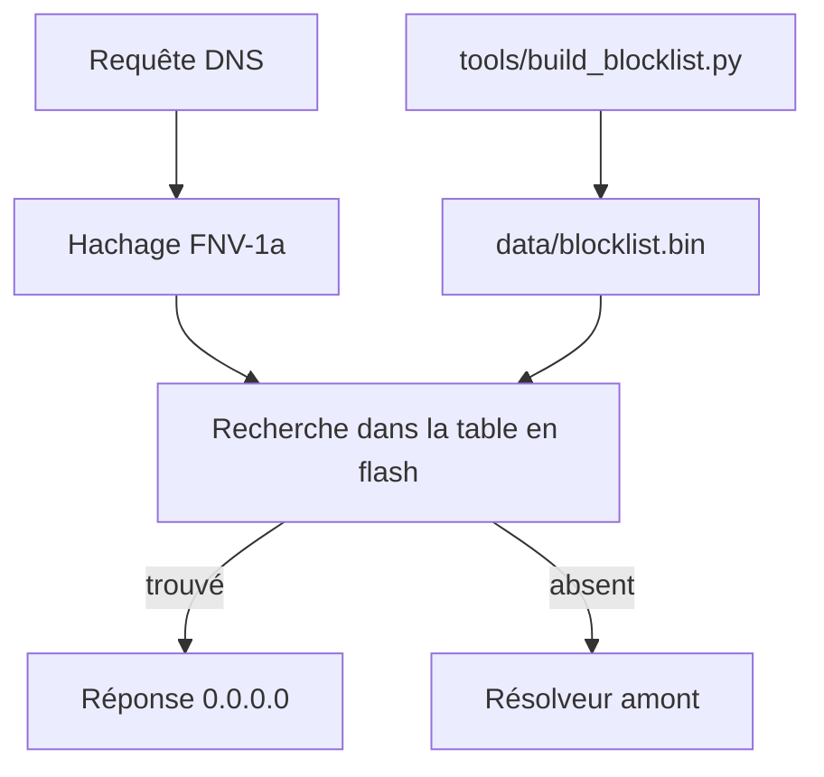

# M-Abozaid/esp32-c3-adblock

> Bloqueur de publicités DNS à la Pi-hole, qui tient sur un ESP32-C3 à deux dollars.

## Le problème
Un bloqueur DNS classique garde la liste de blocage en RAM, ce qui demande du PSRAM ou une machine dédiée.

## Ce que ça fait vraiment
Stocke les domaines sous forme de hachages de 40 bits triés en flash et les cherche par dichotomie : 140 000 domaines tiennent dans environ 0,7 Mo de flash et environ 50 Ko de RAM. Un domaine bloqué reçoit `0.0.0.0`, sinon la requête part vers le résolveur amont (Quad9 par défaut). Tableau de bord web, mises à jour par WiFi (OTA) et portail captif de configuration. Construit aussi pour ESP32 et ESP8266.

## Comment c'est branché
Schéma simplifié d'après la fiche, sans diagramme fourni.


## Essayer
```bash
cp src/secrets.example.h src/secrets.h
python3 tools/build_blocklist.py data/blocklist.bin
pio run -t upload
pio run -t uploadfs
dig @<c3-ip> doubleclick.net
```

## Coût et pièges
Environ deux dollars de matériel, plus une alimentation USB stable. Les identifiants `WEB_USER`, `WEB_PASS` et `OTA_PASS` de `secrets.h` sont obligatoires. Un PlatformIO récent est requis.

## Ce que ce n'est pas
Pas de HTTPS sur le tableau de bord : le HTTP simple avec authentification basique ne protège que sur le réseau local. Pas de cache DNS ni de DHCP intégré. Il ne gère pas l'IPv6.

## Alternatives
- s60sc/ESP32_AdBlocker : l'idée de départ, mais il charge la liste en RAM (cité dans le README).

## Pour toi
À ignorer : un projet de bricolage réseau sans rapport avec la data ou l'IA, même si l'astuce du hachage en flash est élégante.

