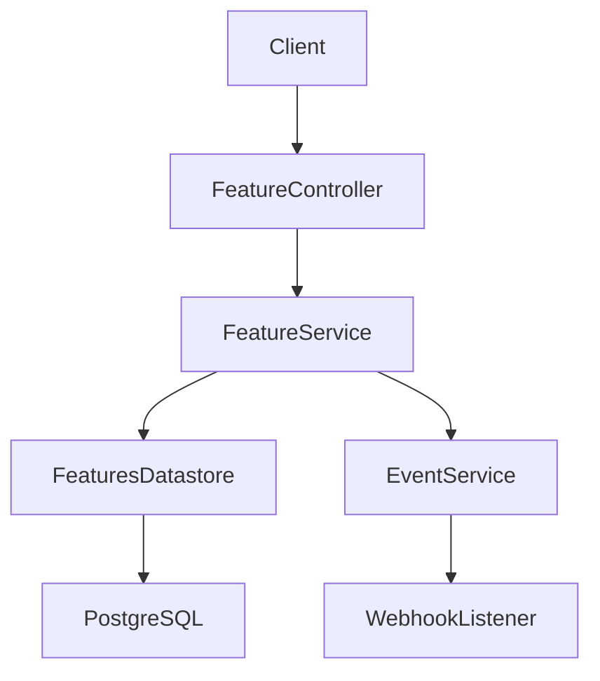

# MAIF/izanami

> Centralized feature flag service, with permissions, audit log and webhooks, for several applications.

## The problem
Turning a feature on or off without redeploying, while sharing flags across applications.

## What it actually does
Clients request flags evaluated by the API; administrators manage tenants, projects, contexts, tags, permissions and imports through a frontend. The services rely on PostgreSQL; changes generate events for webhooks. The README does not detail installation.

## How it is wired


## Trying it
```bash
# Aucune commande dans le README : renvoi au guide de démarrage externe.
```

## Cost and gotchas
Free. Requires PostgreSQL and an instance to host; 99 open issues.

## What it is not
Not a full statistical experimentation tool: it toggles features.

## Alternatives
No alternative named in the README.

## For you
Worth watching: useful for progressively rolling out a model or an AI feature in production.
