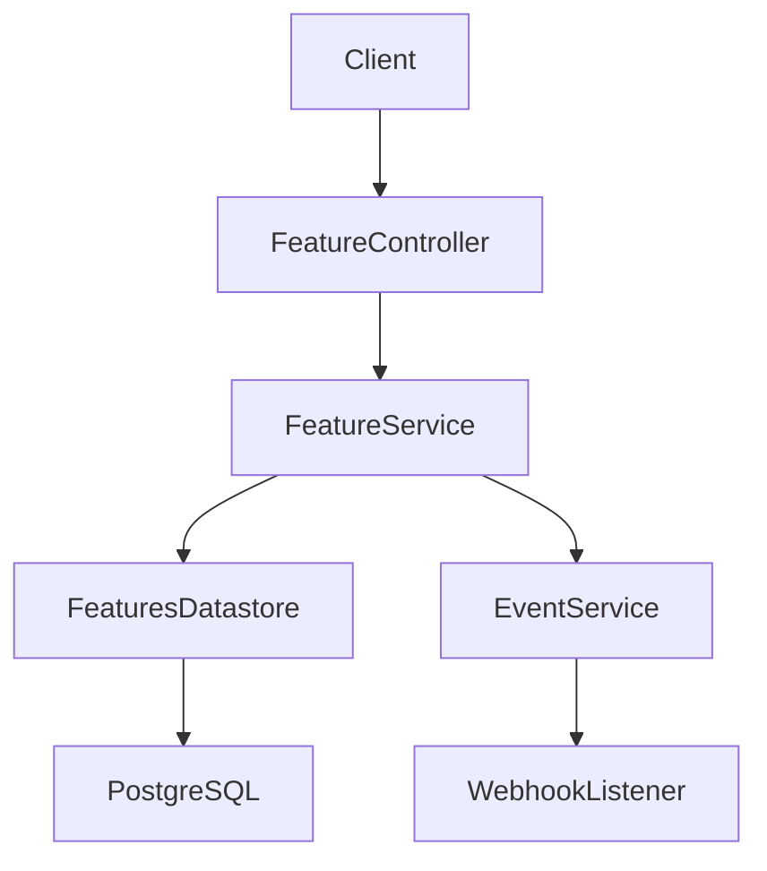

# MAIF/izanami

> Service centralisé de feature flags, avec droits, journal et webhooks, pour plusieurs applications.

## Le problème
Activer ou désactiver une fonctionnalité sans redéployer, en partageant les drapeaux entre applications.

## Ce que ça fait vraiment
Les clients demandent des drapeaux évalués à l'API ; les administrateurs gèrent tenants, projets, contextes, tags, droits et imports via un frontend. Les services s'appuient sur PostgreSQL ; les changements génèrent des événements pour les webhooks. Le README ne détaille pas l'installation.

## Comment c'est branché


## Essayer
```bash
# Aucune commande dans le README : renvoi au guide de démarrage externe.
```

## Coût et pièges
Gratuit. Nécessite PostgreSQL et une instance à héberger ; 99 issues ouvertes.

## Ce que ce n'est pas
Pas un outil d'expérimentation statistique complet : il active des fonctionnalités.

## Alternatives
Aucune alternative nommée dans le README.

## Pour toi
À surveiller : utile pour activer progressivement un modèle ou une fonction IA en production.

