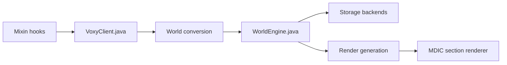

# MCRcortex/voxy

> Fabric mod for Minecraft that adds level-of-detail rendering for distant terrain.

## The problem
Minecraft limits render distance; players want to see farther without collapsing performance.

## What it actually does
The README is a single sentence ("LoD rendering mod for minecraft"). Judging from the code architecture: a Fabric/Mixin mod that voxelizes chunks, maintains a multi-level section engine, stores in LMDB, RocksDB or Redis, and draws via OpenGL 4.6 with hierarchical GPU culling. Compatible with Sodium, Iris, Nvidium, Flashback, Chunky.

## How it is wired

## Trying it
No documented command.

## Cost and gotchas
Free. Requires an OpenGL 4.6 compatible GPU (inferred from the code). License present but not identified by GitHub.

## What it is not
Not a tool outside Minecraft. Minimal sheet: insufficient README, 250 open issues.

## Alternatives
No alternative named in the README.

## For you
Ignore: game mod unrelated to data or AI.
