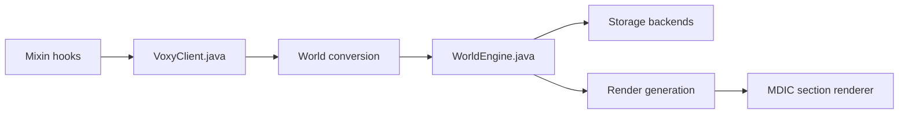

# MCRcortex/voxy

> Mod Fabric pour Minecraft qui ajoute un rendu à niveaux de détail pour les terrains lointains.

## Le problème
Minecraft limite la distance d'affichage ; les joueurs veulent voir plus loin sans effondrer les performances.

## Ce que ça fait vraiment
Le README tient en une phrase (« LoD rendering mod for minecraft »). D'après l'architecture du code : mod Fabric/Mixin qui voxelise les chunks, maintient un moteur de sections multi-niveaux, stocke en LMDB, RocksDB ou Redis, et dessine via OpenGL 4.6 avec culling hiérarchique GPU. Compatibilité Sodium, Iris, Nvidium, Flashback, Chunky.

## Comment c'est branché

## Essayer
Aucune commande documentée.

## Coût et pièges
Gratuit. Exige un GPU compatible OpenGL 4.6 (déduit du code). Licence présente mais non identifiée par GitHub.

## Ce que ce n'est pas
Pas un outil hors Minecraft. Fiche minimale : README insuffisant, 250 issues ouvertes.

## Alternatives
Aucune alternative nommée dans le README.

## Pour toi
À ignorer : mod de jeu sans lien avec la data ou l'IA.

