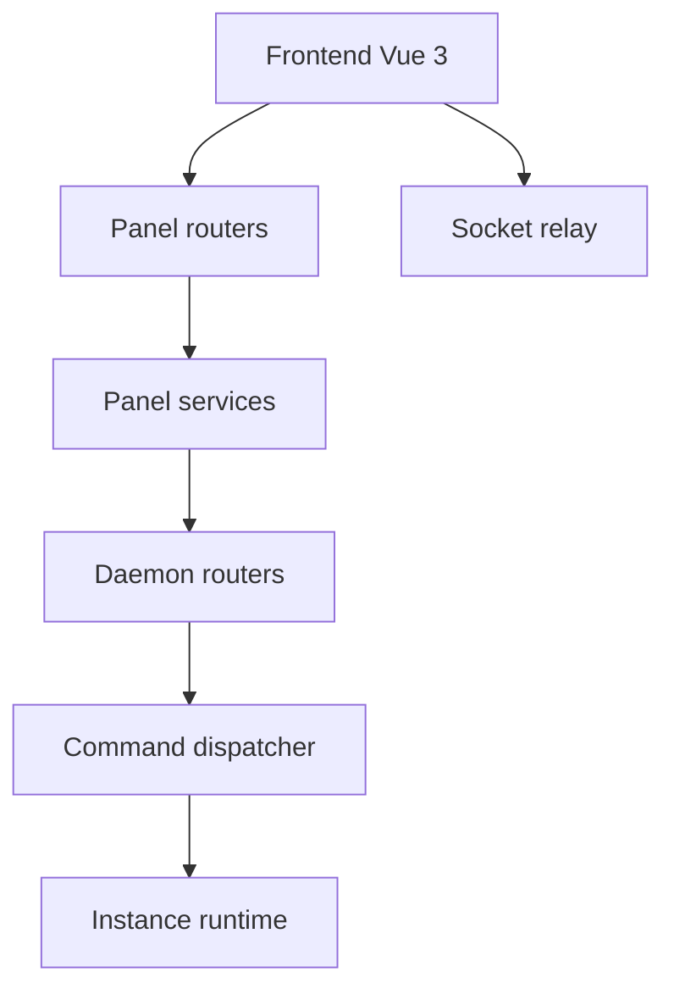

# MCSManager/MCSManager

> Distributed web panel for managing Minecraft and Steam game servers, for administrators.

## The problem
Managing several game servers across several machines, with per-user permissions, is done by hand.

## What it actually does
A panel (Node.js/TypeScript) manages users and permissions, and relays orders to daemons installed on each machine. The daemon launches processes or Docker containers, manages files and opens a web terminal. Vue 3 interface, no database to install, ports 23333 (web) and 24444 (daemon).

## How it is wired


## Trying it
```bash
sudo su -c "wget -qO- https://script.mcsmanager.com/setup.sh | bash"
systemctl start mcsm-{web,daemon}
```

## Cost and gotchas
Free. Node.js 22.23.4 minimum. With Docker, the daemon mounts the host's Docker socket (extended privileges) and the node must be created by hand.

## What it is not
Not a data or AI tool. Not a gaming platform: it is an administration panel.

## Alternatives
No alternative named in the README.

## For you
Ignore it for a data/AI/MLOps profile: no link with your work, unless you host game servers.
