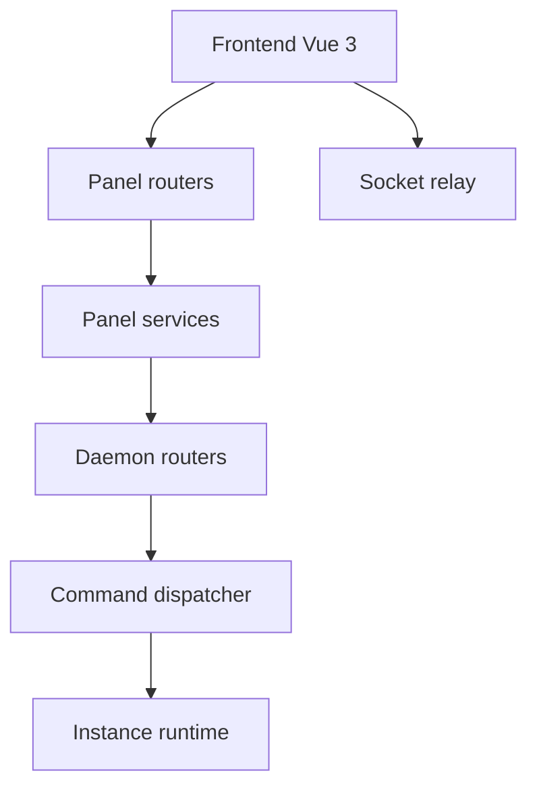

# MCSManager/MCSManager

> Panneau web distribué pour gérer des serveurs de jeu Minecraft et Steam, pour administrateurs.

## Le problème
Gérer plusieurs serveurs de jeu sur plusieurs machines, avec des droits par utilisateur, se fait à la main.

## Ce que ça fait vraiment
Un panneau (Node.js/TypeScript) gère utilisateurs et permissions, et relaie les ordres vers des daemons installés sur chaque machine. Le daemon lance des processus ou des conteneurs Docker, gère les fichiers et ouvre un terminal web. Interface Vue 3, sans base de données à installer, ports 23333 (web) et 24444 (daemon).

## Comment c'est branché


## Essayer
```bash
sudo su -c "wget -qO- https://script.mcsmanager.com/setup.sh | bash"
systemctl start mcsm-{web,daemon}
```

## Coût et pièges
Gratuit. Node.js 22.23.4 minimum. En Docker, le daemon monte le socket Docker de l'hôte (droits étendus) et il faut créer le nœud à la main.

## Ce que ce n'est pas
Pas un outil de données ou d'IA. Pas une plateforme de jeu : c'est un panneau d'administration.

## Alternatives
Aucune alternative nommée dans le README.

## Pour toi
À ignorer pour un profil data/IA/MLOps : aucun lien avec ton métier, sauf si tu héberges des serveurs de jeu.

