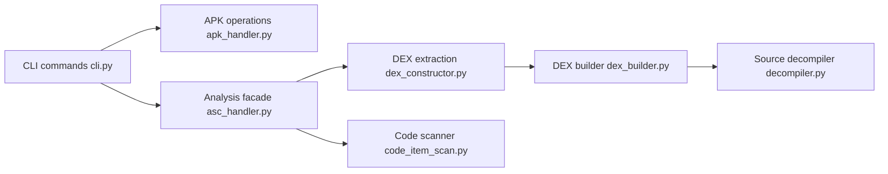

# MG1937/ASC

> Command-line tool that decompiles Android APK classes on demand, with no prior indexing.

## The problem
Classic decompilers bloat the APK, consuming gigabytes and minutes to build indexes before the first search.

## What it actually does
Treats the APK as a read-only database. Locates a class, extracts a DEX in memory, rebuilds a minimal DEX and then decompiles it. Reference search (string, type, method, field) across all DEX files, class listing, manifest decoding. The README claims 1.79 s for a global search and 177 ms for decompilation on a 352 MB APK with 141 MB of RAM (figures not verified). Optional graphical interface.

## How it is wired


## Trying it
```bash
pip install droidasc
droidasc getclass app.apk com.poc.Main -o Main.java
droidasc listclass app.apk --prefix com.poc
droidasc getmanifest app.apk -o AndroidManifest.xml
droidasc findrefs app.apk string token -o string_refs.txt
```

## Cost and gotchas
Free, installed via PyPI. The repo was created in June 2026 and presented at Black Hat Europe Arsenal. The gains depend on the behavior of the R8 compiler: non-optimized APKs need testing.

## What it is not
Not a deobfuscation or dynamic analysis tool. It extracts code from an APK; use must stay within an authorized framework.

## Alternatives
Androguard is used internally according to the diagram, but the README names no alternative.

## For you
Worth watching: outside your data/AI domain, useful only if you analyze APKs; its approach of "querying the artifact without preprocessing" is interesting but recent and carried by one person.
