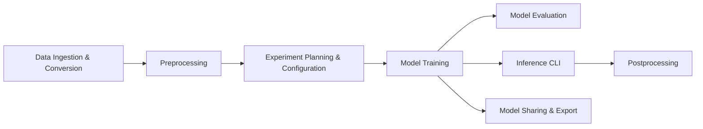

# MIC-DKFZ/nnUNet

> Semantic segmentation framework that automatically configures a U-Net pipeline for each image dataset.

## The problem
Every new medical image dataset requires manually tuning preprocessing, architecture and training, with no reliable starting point.

## What it actually does
nnU-Net analyzes the data, computes a dataset "fingerprint", derives 2D/3D U-Net configurations from it (and a cascade if useful), then chains preprocessing (cropping, resampling, normalization), training, model selection, sliding-window inference, postprocessing and ensembles. Supports 2D and 3D, arbitrary channels, several formats. v2 is a complete rewrite.

## How it is wired


## Trying it
```bash
pip install nnunetv2
```

## Cost and gotchas
Free; first install the PyTorch build suited to your hardware and set `nnUNet_raw`, `nnUNet_preprocessed`, `nnUNet_results`. 3D training is GPU-hungry.

## What it is not
Not a detection or classification tool: only supervised semantic segmentation. Not designed to reuse models pretrained on natural images.

## Alternatives
No named alternative; the v1 branch remains available for the old version.

## For you
Adopt whenever a project involves image segmentation (medical or non-standard): it is the auto-configured reference baseline, maintained by DKFZ, against which any method will be judged.
