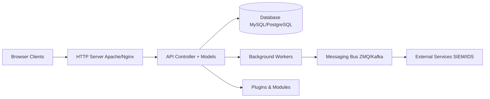

# MISP/MISP

> Open platform to collect, store and share threat indicators between security teams.

## The problem
Security analysts exchange their indicators of compromise in bulk (emails, PDFs, spreadsheets). Without a common format or correlation, nothing is reusable by IDS or SIEM tools.

## What it actually does
- Stores events, attributes and structured objects, with a correlation engine (including fuzzy hashes and CIDR blocks).
- Synchronizes events between instances, with sharing groups and fine-grained filters.
- Exports to STIX 1/2, OpenIOC, CSV, Suricata/Snort/Zeek rules; imports free text and various formats.
- Exposes a REST API (OpenAPI) and PyMISP; taxonomies and "galaxies" (ATT&CK, malware families).

## How it is wired


## Trying it
No installation command in the README: it points to misp-project.org/download for deployment options.

```bash
# non documenté dans le README — voir misp-project.org/download
```

## Cost and gotchas
Free software, but to be self-hosted (web server, SQL database, workers); the README also mentions SaaS offerings. 2,956 open issues: tracking at the scale of a large project. Sensitive data: GDPR and sector-specific responsibility rests with the operator.

## What it is not
It is not a SIEM or a detection tool: it provides the intelligence that other tools consume. Its value depends on the communities you synchronize with. The stable branch is 2.5; 2.4 is no longer maintained after April 2025.

## Alternatives
- OpenCTI: another threat intelligence platform (cited in the OSINT list of the same block).
- YETI: a lighter platform, mentioned in the same place.

## For you
Watch: useful if you build a cyber intelligence pipeline (PyMISP, STIX exports), irrelevant for pure MLOps; the AGPL license requires publishing the modifications of an exposed service.
