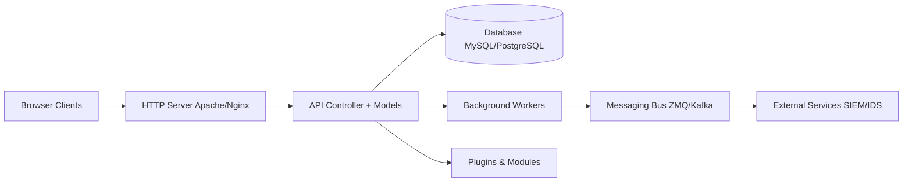

# MISP/MISP

> Plateforme libre pour collecter, stocker et partager des indicateurs de menace entre équipes de sécurité.

## Le problème
Les analystes sécurité échangent leurs indicateurs de compromission en vrac (mails, PDF, tableurs). Sans format commun ni corrélation, rien n'est réutilisable par les IDS ou les SIEM.

## Ce que ça fait vraiment
- Stocke événements, attributs et objets structurés, avec un moteur de corrélation (dont hachages flous et blocs CIDR).
- Synchronise événements entre instances, avec groupes de partage et filtres fins.
- Exporte vers STIX 1/2, OpenIOC, CSV, règles Suricata/Snort/Zeek ; importe du texte libre et des formats variés.
- Expose une API REST (OpenAPI) et PyMISP ; taxonomies et « galaxies » (ATT&CK, familles de malwares).

## Comment c'est branché


## Essayer
Aucune commande d'installation dans le README : il renvoie vers misp-project.org/download pour les options de déploiement.

```bash
# non documenté dans le README — voir misp-project.org/download
```

## Coût et pièges
Logiciel gratuit, mais à héberger soi-même (serveur web, base SQL, workers) ; le README évoque aussi des offres SaaS. 2 956 issues ouvertes : suivi à l'échelle d'un gros projet. Données sensibles : responsabilité RGPD et sectorielle à la charge de l'opérateur.

## Ce que ce n'est pas
Ce n'est pas un SIEM ni un outil de détection : il fournit le renseignement que d'autres outils consomment. Sa valeur dépend des communautés avec lesquelles on synchronise. La branche stable est 2.5 ; la 2.4 n'est plus maintenue après avril 2025.

## Alternatives
- OpenCTI : autre plateforme de renseignement sur les menaces (citée dans la liste OSINT du même bloc).
- YETI : plateforme plus légère, mentionnée au même endroit.

## Pour toi
Surveiller : utile si tu montes un pipeline de renseignement cyber (PyMISP, exports STIX), sans objet pour du MLOps pur ; la licence AGPL impose de publier les modifications d'un service exposé.

