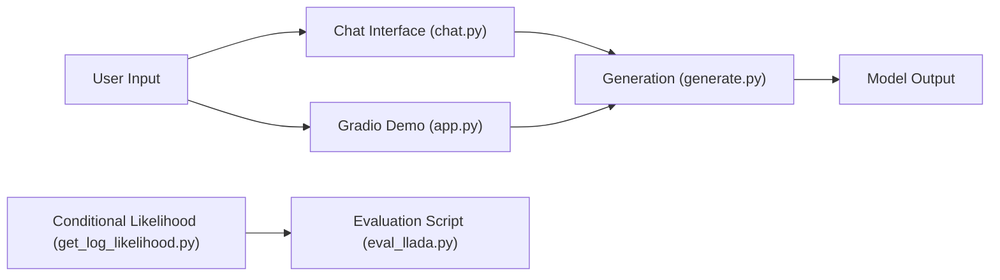

# ML-GSAI/LLaDA

> 8-billion-parameter language model based on masked diffusion rather than autoregression, for researchers.

## The problem
LLMs predict the next word; this family explores another way of modeling language, through masked diffusion.

## What it actually does
The repository provides inference code for LLaDA-8B-Base and LLaDA-8B-Instruct (weights on Hugging Face): `generate.py` (generation), `get_log_likelihood.py` (likelihood), `chat.py` (conversation) and a Gradio demo (`app.py`). It includes evaluation code (lm-evaluation-harness). Announced novelties: LLaDA-V, LLaDA 1.5, LLaDA-MoE and iLLaDA. Training code and data are not published; the README points to `GUIDELINES.md` and to SMDM.

## How it is wired


## Trying it
```bash
pip install transformers==4.38.2
pip install gradio
python app.py
python chat.py
```

## Cost and gotchas
A GPU is required for an 8B model. Loading goes through `trust_remote_code=True`. The `transformers` version is pinned to 4.38.2. The catalog reports no license for the repository: rights on the code are not declared. Generation is slower than an autoregressive model: fixed context, no KV cache, best performance when the number of steps equals the response length.

## What it is not
It is not a model ready to serve in production: the README admits a lower sampling speed. The model answers "Bailing" to "Who are you?", because its training data carries identity markers.

## Alternatives
- SMDM: open training framework with a similar process, cited by the README for training your own variant.

## For you
Keep an eye on it: it is a research signal on diffusion LLMs, but slow, without training code and without a license declared on the repository: reserve it for exploration.
