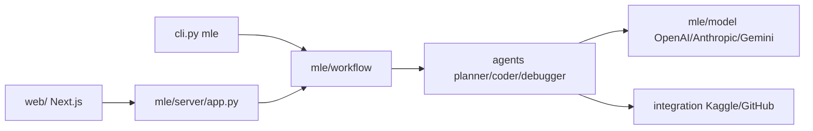

# MLSysOps/MLE-agent

> Command-line LLM agent that assists ML engineers: baselines, Kaggle, debugging, reports.

## The problem
Setting up an ML baseline, fixing your code and summarizing your week of work are repetitive tasks you would like to delegate to an assistant.

## What it actually does
The `mle` package offers `mle new`, `mle start` (prototypes a baseline), `mle chat`, `mle kaggle` (including `--auto`) and `mle report` / `report-local` (report from GitHub or a local repository). Specialized agents (advisor, planner, coder, debugger, summarizer) are driven by workflows, with an HTTP server and a Next.js front end for reports. Several LLM providers are supported.

## How it is wired


## Trying it
```bash
pip install -U mle-agent
mle new <project name>
cd <project name>
mle start
mle chat
```

## Cost and gotchas
Free, but LLM calls are at your expense (a provider key). Kaggle mode requires having joined the competition and providing datasets and a submission file.

## What it is not
Not a substitute for an engineer: LLM-generated code to be reviewed. The README milestones stop in September 2024 while the repository was pushed in 2026: documentation possibly out of date.

## Alternatives
No alternative named in the README.

## For you
Worth watching: the idea is close to your job, but the agent is experimental and its README does not reflect the recent state of the code.
