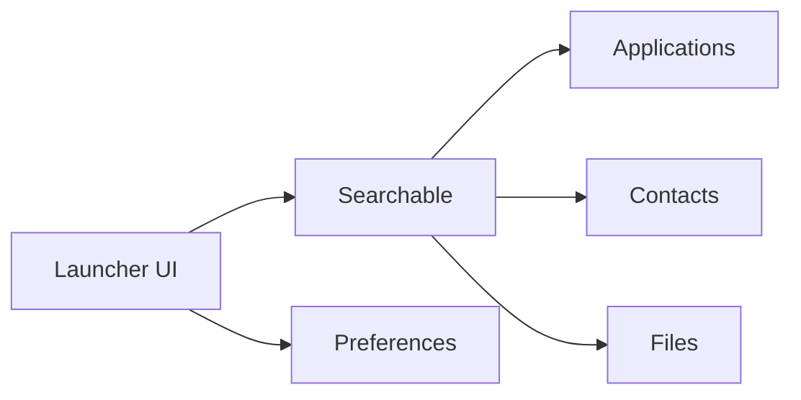

# MM2-0/Kvaesitso

> Free Android launcher centered on search, for advanced users.

## The problem
Conventional launchers make searching for apps, contacts and files slow and scattered.

## What it actually does
Replaces the home screen with a unified search: apps, contacts, calendar, files, weather, unit converter, Wikipedia, websites. Separate Gradle modules (core, data, services) and a plugin SDK. Android 8+, Pixel Android 11+ recommended.

## How it is wired

## Trying it
No command: install via F-Droid (repository `https://fdroid.mm20.de/repo/`), IzzyOnDroid or the APK from the releases page.

## Cost and gotchas
Free. The official F-Droid version removes the features that depend on non-free APIs.

## What it is not
Not a desktop productivity tool: it is an Android home screen launcher, which is of no use for data or AI work.

## Alternatives
No alternative cited in the README.

## For you
Ignore: mobile launcher, unrelated to data / AI / MLOps.
