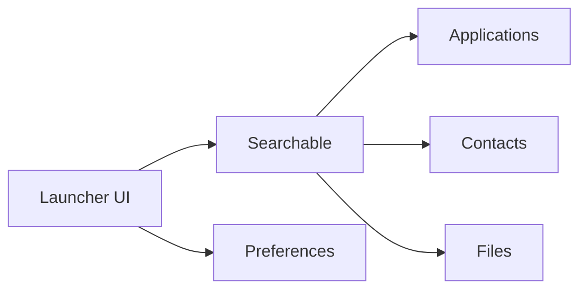

# MM2-0/Kvaesitso

> Lanceur Android libre centré sur la recherche, pour utilisateurs avancés.

## Le problème
Les lanceurs classiques rendent la recherche d'applications, contacts et fichiers lente et dispersée.

## Ce que ça fait vraiment
Remplace l'écran d'accueil par une recherche unifiée : applications, contacts, agenda, fichiers, météo, convertisseur d'unités, Wikipédia, sites web. Modules Gradle séparés (core, data, services) et un SDK de plugins. Android 8+, Pixel Android 11+ recommandé.

## Comment c'est branché

## Essayer
Aucune commande : installation via F-Droid (dépôt `https://fdroid.mm20.de/repo/`), IzzyOnDroid ou APK de la page des releases.

## Coût et pièges
Gratuit. La version F-Droid officielle retire les fonctions dépendant d'API non libres.

## Ce que ce n'est pas
Pas un outil de productivité de bureau.

## Alternatives
Aucune alternative citée dans le README.

## Pour toi
À ignorer : lanceur mobile, sans rapport avec data / IA / MLOps.

