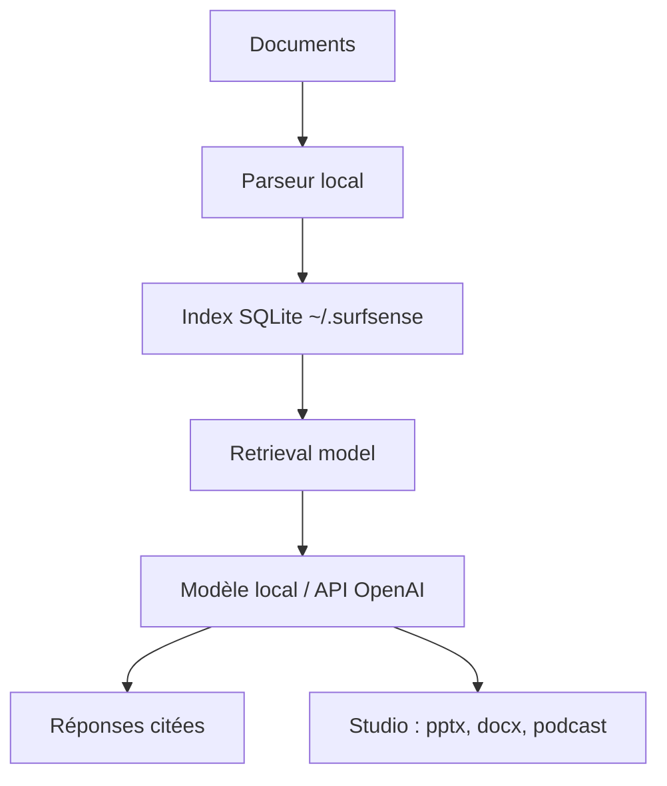

# MODSetter/SurfSense

> Offline desktop alternative to NotebookLM: sourced answers and finished deliverables drawn from your documents.

## The problem
Confidential documents cannot be sent to NotebookLM. Local chat tools, for their part, do not produce finished deliverables.

## What it actually does
Parsing, chunking and embedding all happen locally, in SQLite under `~/.surfsense`.
Answers cite their sources. The Studio module produces summaries, study sheets, quizzes, mind maps, `.pptx`, `.docx`, `.xlsx` and podcasts (Kokoro-82M, running locally).
You choose a local model (Qwen3) or any OpenAI-compatible API. Network output is cut off by default and there is no telemetry.
The hosted web application shuts down on October 18, 2026.

## How it is wired
The provided diagram describes the old web architecture (FastAPI, pgvector). The diagram below follows the 2.0 README.

## Trying it
The README gives no command: installation goes through Windows, macOS and Linux installers.

## Cost and gotchas
The application is free. The installer is heavy because it bundles the models. A local model requires a machine that can handle the load.

## What it is not
It is not a team service. Video is not yet supported. The README claims Apache-2.0, but GitHub does not identify it.

## Alternatives
- Jan, AnythingLLM, Open WebUI, LM Studio: for chatting with a local model, without deliverables.
- NotebookLM: better at audio and video, but documents are sent to Google.

## For you
Worth watching: local RAG with citations and deliverable generation meets a real need on sensitive data, but version 2.0 has only just been released.
