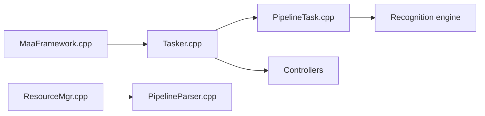

# MaaXYZ/MaaFramework

> Black-box automation and testing framework based on image recognition, for developers.

## The problem
Writing UI tests or automations without access to the target application's code.

## What it actually does
A caller supplies a pipeline (low-code protocol) and connects a controller; the resource manager loads it, the Tasker applies recognition and actions on the screenshots, and the controller sends the inputs. Multi-language bindings, device discovery, remote agents, recording and replay. Many community projects (mostly game assistants).

## How it is wired

## Trying it
No command: the README points to the website (quick start, API, Pipeline protocol) and to the build guide.

## Cost and gotchas
GPU acceleration via DirectML (Windows); heavy underlying libs (OpenCV, ONNX). README in Chinese, with clauses forbidding anti-cheat circumvention.

## What it is not
Not a classic web or API testing tool; it acts on screens.

## Alternatives
- ok-script: Python game automation framework that the README draws inspiration from.

## For you
Ignore: vision-based automation, mostly game-oriented, far from your MLOps uses.
