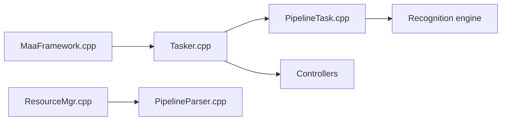

# MaaXYZ/MaaFramework

> Framework d'automatisation et de tests boîte noire par reconnaissance d'image, pour développeurs.

## Le problème
Écrire des tests ou automatisations d'interface sans accès au code de l'application cible.

## Ce que ça fait vraiment
Un appelant fournit un pipeline (protocole bas-code), connecte un contrôleur ; le gestionnaire de ressources le charge, le Tasker applique reconnaissance et actions sur les captures d'écran, le contrôleur envoie les entrées. Bindings multilingues, découverte d'appareils, agents distants, enregistrement et relecture. Nombreux projets communautaires (surtout des assistants de jeux).

## Comment c'est branché

## Essayer
Aucune commande : le README renvoie au site (démarrage rapide, API, protocole Pipeline) et au guide de construction.

## Coût et pièges
Accélération GPU via DirectML (Windows) ; libs de recherche lourdes (OpenCV, ONNX). README en chinois, avec clauses interdisant contournement d'anti-triche.

## Ce que ce n'est pas
Pas un outil de test web ou d'API classique ; il agit sur des écrans.

## Alternatives
- ok-script : framework Python d'automatisation de jeux dont le README s'inspire.

## Pour toi
À ignorer : automatisation par vision, surtout orientée jeux, loin de tes usages MLOps.

