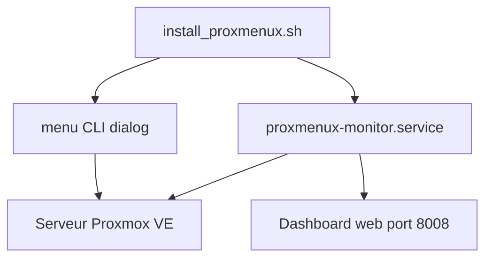

# MacRimi/ProxMenux

> Menu-driven toolbox for Proxmox VE servers, with a web monitoring dashboard, for homelabs.

## The problem
Configuring Proxmox after installation, backing up and monitoring a homelab requires a lot of manual commands.

## What it actually does
An install script launches the `menu` command, a `dialog`-based text interface for post-install, backup and restore. A Flask dashboard (ProxMenux Monitor) runs as a systemd service on port 8008: CPU, RAM, disk, network, VMs and LXC containers, authentication and TOTP 2FA.

## How it is wired
Simplified diagram based on the sheet, no diagram provided.


## Trying it
```bash
bash -c "$(wget -qLO - https://raw.githubusercontent.com/MacRimi/ProxMenux/main/install_proxmenux.sh)"
menu
```

## Cost and gotchas
Free, GPL-3.0. Installation runs a script downloaded on the server: the README itself advises checking the source. A beta program exists from the develop branch.

## What it is not
Not a general Linux tool: it assumes Proxmox VE. Not a VM orchestrator: it helps manage them. Debian dependencies are installed automatically.

## Alternatives
No alternative named in the README.

## For you
Ignore: useful only if your infrastructure runs on Proxmox, which the README does not link to any data or MLOps use.
