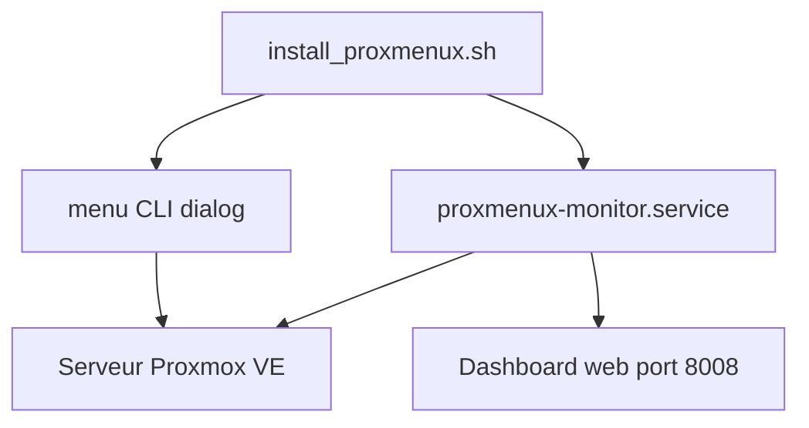

# MacRimi/ProxMenux

> Boîte à outils à menus pour serveur Proxmox VE, avec tableau de bord web de supervision, pour homelabs.

## Le problème
Configurer Proxmox après installation, sauvegarder et surveiller un homelab demande beaucoup de commandes manuelles.

## Ce que ça fait vraiment
Un script d'installation lance la commande `menu`, une interface texte basée sur `dialog` pour le post-install, la sauvegarde et la restauration. Un tableau de bord Flask (ProxMenux Monitor) tourne en service systemd sur le port 8008 : CPU, RAM, disque, réseau, VM et conteneurs LXC, authentification et 2FA TOTP.

## Comment c'est branché
Schéma simplifié d'après la fiche, sans diagramme fourni.


## Essayer
```bash
bash -c "$(wget -qLO - https://raw.githubusercontent.com/MacRimi/ProxMenux/main/install_proxmenux.sh)"
menu
```

## Coût et pièges
Gratuit, GPL-3.0. L'installation exécute un script téléchargé sur le serveur : le README lui-même conseille de vérifier la source. Un programme bêta existe depuis la branche develop.

## Ce que ce n'est pas
Pas un outil général Linux : il suppose Proxmox VE. Pas un orchestrateur de VM : il aide à les gérer. Dépendances Debian installées automatiquement.

## Alternatives
Aucune alternative nommée dans le README.

## Pour toi
À ignorer : utile seulement si ton infrastructure tourne sur Proxmox, ce que le README ne relie à aucun usage data ou MLOps.

