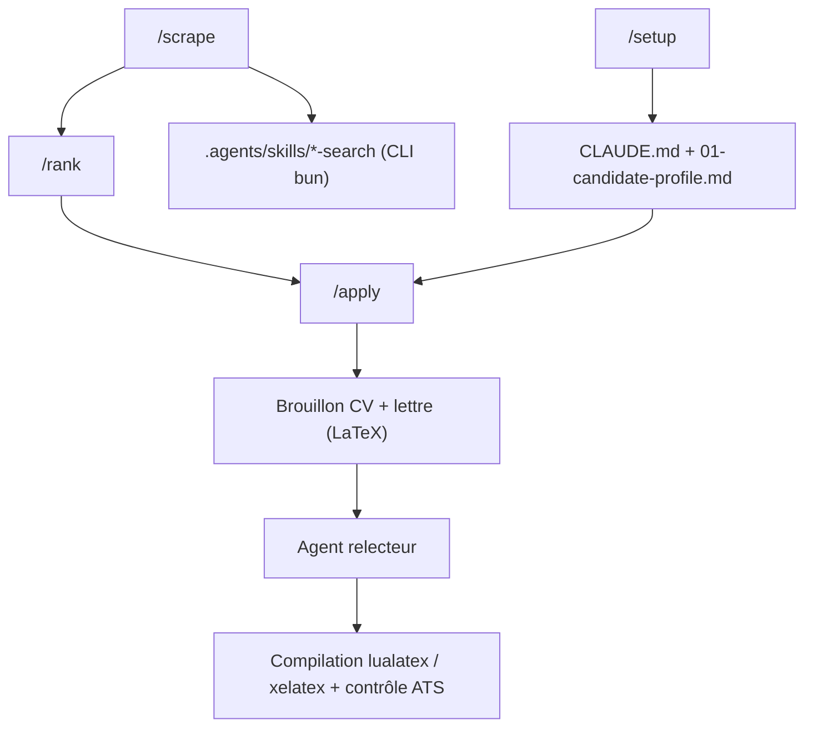

# MadsLorentzen/ai-job-search

> Job search platform based on Claude Code: filtering, resume creation, cover letters, and interview preparation.

## The problem
To apply seriously requires careful review of the job description, tailoring the resume, writing a cover letter, and preparing thoroughly – which can take several hours per application, and must be repeated for each job opportunity.

## What it actually does
`/setup` builds your profile from a folder of documents, a pasted-in CV, or a guided interview.
`/scrape` queries job boards, deduplicates, and sorts by relevance; `/rank` scores the results.
`/apply` evaluates the job offer, writes a CV and cover letter in LaTeX, has a second agent review drafts, revises, compiles into PDF, and checks the final result, which can include up to 2 pages of CV and 1 page of cover letter.
It then extracts the text layer from the PDF to verify what an ATS (Applicant Tracking System) would read. Ten other commands follow: `/outcome`, `/interview`, `/upskill`, `/html-report`, `/notion-sync`, `/gmail-sync`.

## How it is wired


## Trying it
```bash
gh repo fork MadsLorentzen/ai-job-search --clone
cd ai-job-search
for tool in jobbank-search jobdanmark-search jobindex-search jobnet-search linkedin-search freehire-search; do
  (cd .agents/skills/$tool/cli && bun install)
done
claude
# puis dans Claude Code : /setup, /scrape, /apply <url>
```

## Cost and gotchas
Claude Code does not offer a free version: you will need to subscribe or purchase API credits. You will also need Python 3.10+, Bun, and a LaTeX distribution with `lualatex` and `xelatex`. A major pitfall highlighted in the README is:
a fork is always public, and the `/setup` command writes your personal data to files that are tracked by Git – this requires a private repository. Scraping LinkedIn is against its terms of service.

## What it is not
This is not a ready-made solution: the "portal" features are targeted at the Danish market, while other markets use `/add-portal`. This is not a sandbox: the defenses against misleading ads are at the level of guidelines, not isolation – you need to review before sending.

## Alternatives
No alternative is specified in the README.

## For you
Rather than being a tool to be adopted, it's more of a case study for a writer/editor pipeline with output verification.
