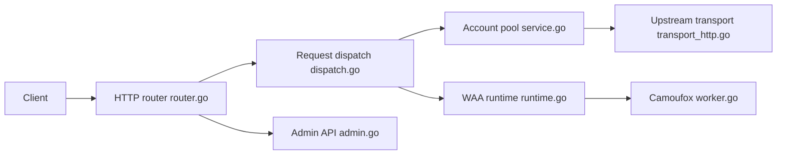

# Mag1cFall/AIStudio2API

> Go proxy that exposes Google AI Studio through OpenAI-, Anthropic- and Gemini-compatible APIs.

## The problem
Agent clients (Claude Code, Codex, Cherry Studio) expect a standard API, while access to Gemini here goes through the AI Studio web interface.

## What it actually does
A Go binary receives requests (Chat, Responses, Messages, Gemini), picks a Google account from a pool and sends them to AI Studio. A Camoufox browser runs the WAA mechanism, or a pure Go mode (`WAA_BACKEND=go`) works without a browser. It also covers TTS, images, Veo video, files, Live, and offers a web admin console.

## How it is wired


## Trying it
```bash
mkdir aistudio2api && cd aistudio2api
curl -fsSLO https://raw.githubusercontent.com/Mag1cFall/AIStudio2API/main/docker-compose.yml
mkdir data
# créer data/.env avec PROXY_API_KEY et ADMIN_PASSWORD (voir README)
docker compose up -d
```

## Cost and gotchas
A Google account is required; usage is limited by AI Studio's Free/Pro/Ultra quotas. About 2 GB of RAM for one account, plus 0.6 GB for each pre-warmed account. The container runs as root.

## What it is not
Not the official Gemini API: it automates the web interface with anti-detection browser fingerprints, which may violate Google's terms of use and can break without notice. The `-build` variants inject a system prompt.

## Alternatives
No alternative named in the README.

## For you
Worth watching: handy for plugging Gemini into your agents, but fragile and risky for a Google account; in production, prefer the official API with a key.
