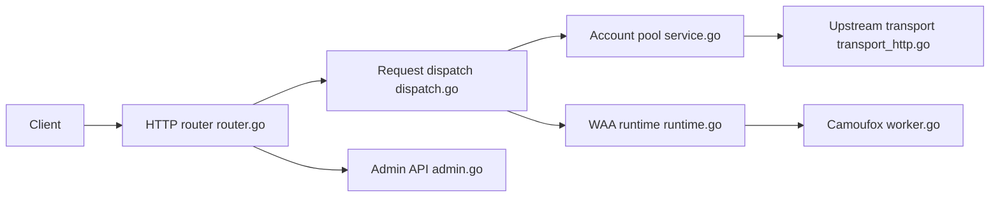

# Mag1cFall/AIStudio2API

> Proxy Go qui expose Google AI Studio via des API compatibles OpenAI, Anthropic et Gemini.

## Le problème
Les clients agents (Claude Code, Codex, Cherry Studio) attendent une API standard, alors que l'accès à Gemini passe ici par l'interface web d'AI Studio.

## Ce que ça fait vraiment
Un binaire Go reçoit les requêtes (Chat, Responses, Messages, Gemini), choisit un compte Google dans un pool et les envoie à AI Studio. Un navigateur Camoufox exécute le mécanisme WAA, ou un mode Go pur (`WAA_BACKEND=go`) sans navigateur. Il couvre aussi TTS, images, vidéo Veo, fichiers, Live, et propose une console web d'administration.

## Comment c'est branché


## Essayer
```bash
mkdir aistudio2api && cd aistudio2api
curl -fsSLO https://raw.githubusercontent.com/Mag1cFall/AIStudio2API/main/docker-compose.yml
mkdir data
# créer data/.env avec PROXY_API_KEY et ADMIN_PASSWORD (voir README)
docker compose up -d
```

## Coût et pièges
Il faut un compte Google ; l'usage est limité par les quotas Free/Pro/Ultra d'AI Studio. Environ 2 Go de RAM pour un compte, plus 0,6 Go par compte préchauffé. Le conteneur tourne en root.

## Ce que ce n'est pas
Pas l'API officielle Gemini : il automatise l'interface web avec des empreintes de navigateur anti-détection, ce qui peut contrevenir aux conditions d'usage de Google et casser sans préavis. Les `-build` injectent un prompt système.

## Alternatives
Aucune alternative nommée dans le README.

## Pour toi
À surveiller : pratique pour brancher Gemini sur tes agents, mais fragile et risqué pour un compte Google ; en production, préfère l'API officielle avec clé.

