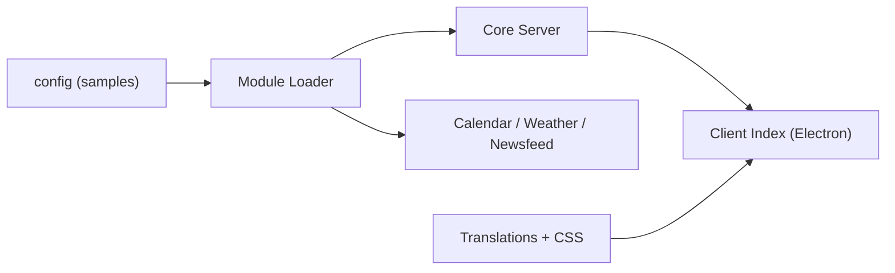

# MagicMirrorOrg/MagicMirror

> Modular smart-mirror platform on Electron, for tinkerers who want an assistant on a mirror.

## The problem
Displaying time, calendar, weather and news on a screen behind a mirror means assembling the interface yourself.

## What it actually does
A Node/Electron application with a module loader: clock, calendar, weather, news feeds, compliments, alerts, update notification. Each module can have its own scripts, styles, templates and a `node_helper`. Client-only and server-only entry points exist. Detailed installation is only in the online documentation.

## How it is wired

## Trying it
No command documented in the README provided; installation via https://docs.magicmirror.builders.

## Cost and gotchas
Free. Hardware (screen, two-way mirror, Raspberry Pi) is at your expense, not documented here. Community modules call external APIs.

## What it is not
It is not a voice assistant or a home-automation platform: it is a modular display.

## Alternatives
No alternative named in the README.

## For you
Ignore: a home DIY project unrelated to data or MLOps.
