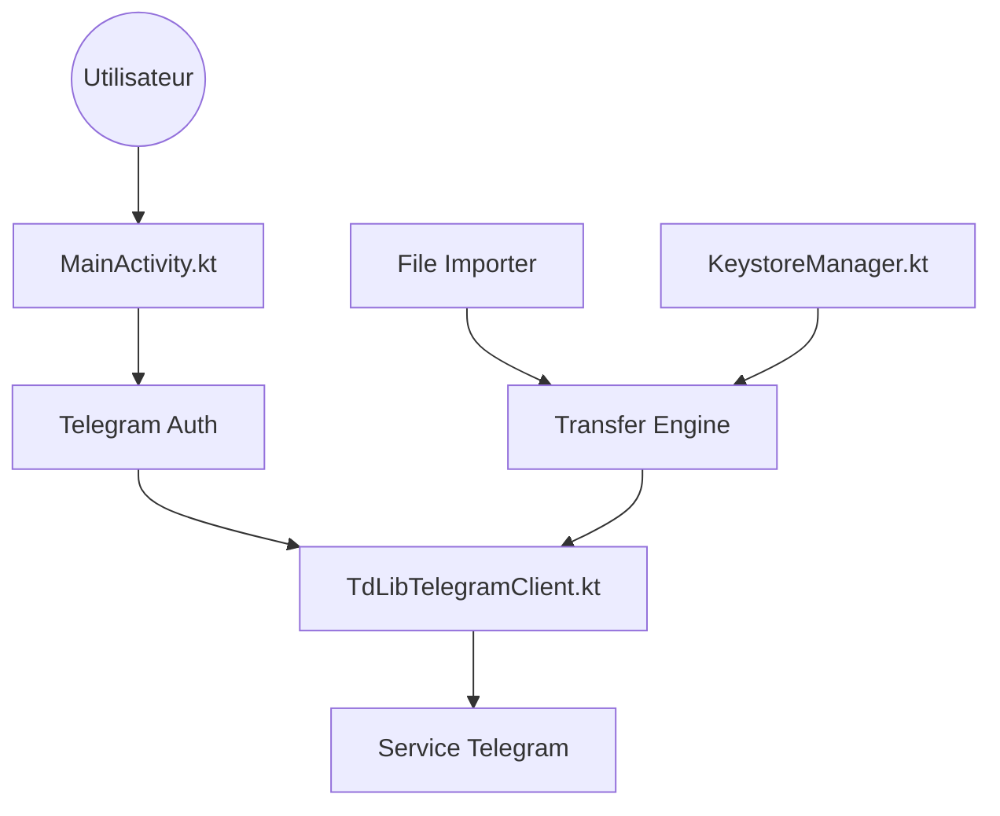

# Mahmud0808/TeleDrive

> Android and desktop client that backs up and browses your files in a private Telegram channel.

## The problem
Store large backups without paying for a storage service or depending on a third-party server.

## What it actually does
Each file becomes a message in your channel; a local database (Room) indexes and speeds up search. Automatic backup of photos and folders on Android, optional AES-256-GCM encryption (names, captions, folder tree), files of unlimited size through chunking, streaming playback, several players, transfer resumption, biometric lock.

## How it is wired


## Trying it
```bash
git clone https://github.com/Mahmud0808/TeleDrive.git
cd TeleDrive
./gradlew :android:installDebug
./gradlew :desktop:run
```

## Cost and gotchas
Telegram account and personal API credentials (my.telegram.org). No recovery of the passphrase. A chunked file appears as parts in Telegram. macOS build unsigned, Apple Silicon only.

## What it is not
Not a storage independent of Telegram: everything depends on that service and its rules. Streaming only authenticates the frames that are read.

## Alternatives
No alternative named in the README.

## For you
Watch: a clever personal backup, but unsuitable for sensitive or critical datasets as long as everything relies on Telegram.
