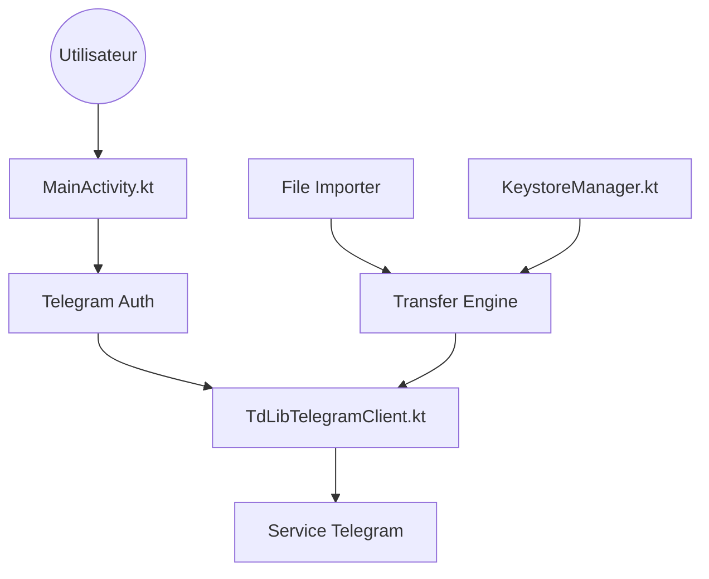

# Mahmud0808/TeleDrive

> Client Android et bureau qui sauvegarde et parcourt vos fichiers dans un canal Telegram privé.

## Le problème
Stocker des sauvegardes volumineuses sans payer un service de stockage ni dépendre d'un serveur tiers.

## Ce que ça fait vraiment
Chaque fichier devient un message dans votre canal ; une base locale (Room) indexe et accélère la recherche. Sauvegarde automatique des photos et dossiers sur Android, chiffrement AES-256-GCM optionnel (noms, légendes, arbre de dossiers), fichiers sans limite de taille via découpage, lecture en flux, plusieurs lecteurs, reprise des transferts, verrou biométrique.

## Comment c'est branché


## Essayer
```bash
git clone https://github.com/Mahmud0808/TeleDrive.git
cd TeleDrive
./gradlew :android:installDebug
./gradlew :desktop:run
```

## Coût et pièges
Compte Telegram et identifiants API personnels (my.telegram.org). Aucune récupération de la phrase secrète. Un fichier découpé apparaît en parties dans Telegram. Build macOS non signé, Apple Silicon seulement.

## Ce que ce n'est pas
Pas un stockage indépendant de Telegram : tout dépend de ce service et de ses règles. Le streaming n'authentifie que les trames lues.

## Alternatives
Aucune alternative nommée dans le README.

## Pour toi
Surveiller : sauvegarde personnelle astucieuse, mais inadaptée à des jeux de données sensibles ou critiques tant que tout repose sur Telegram.

