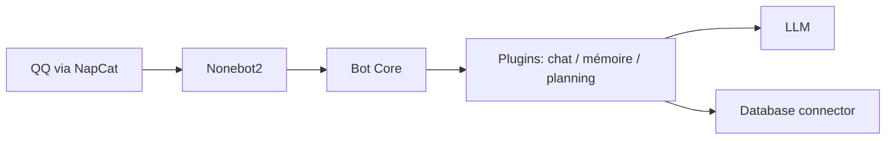

# MaiM-with-u/MaiBot

> Conversational agent (MaiSaka) that imitates human style in QQ groups, with memory and plugins.

## The problem
Classic assistants answer with long, rigid replies; here the goal is a companion with a natural tone in group discussions.

## What it actually does
Bilingual Chinese/English LLM-based bot that chooses when to speak, imitates the style of the people it talks to, learns group vocabulary and accumulates knowledge about users. A plugin system exposes APIs and events. According to the provided code (old MaiMBot version): nonebot2, NapCat protocol, MongoDB, chat, memory, personality and planning plugins.

## How it is wired

## Trying it
No command documented in the provided README (it refers to a deployment guide and a Windows/macOS launcher).

## Cost and gotchas
LLM API keys at your expense, QQ account and NapCat required. The provided diagram describes an older version and may no longer reflect v1.2.5.

## What it is not
Not a productivity assistant: the README says it aims for "the most lifelike, not the best". QQ-oriented, so of little use outside that ecosystem.

## Alternatives
AstrBot (LLM agent project cited among "open source friends").

## For you
Ignore: a companion bot tied to QQ, outside the data/AI/MLOps scope, whose useful documentation is elsewhere.
