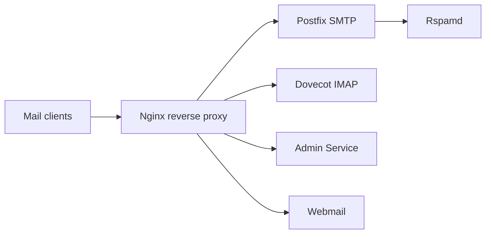

# Mailu/Mailu

> Complete mail server distributed as Docker images, for self-hosting.

## The problem
Setting up a mail server (SMTP, IMAP, antispam, webmail) by hand is long and fragile.

## What it actually does
A set of containers: Nginx as front end, Postfix (SMTP), Dovecot (IMAP), Rspamd (antispam), antivirus, DKIM, webmails and an admin interface. Announced features: aliases, quotas, DANE, MTA-STS, Let's Encrypt, passkeys. Optional components: Fetchmail, Radicale, Unbound.

## How it is wired

## Trying it
No command in the README: documentation and demo on the project website.

## Cost and gotchas
Free, but DNS, ports 25/143/993/587 and IP reputation are at your expense. License present but not identified by GitHub (the README says MIT-compatible).

## What it is not
Not a groupware (calendar, collaboration): the project excludes it. Not a managed service.

## Alternatives
No alternative named in the README.

## For you
Ignore: mail administration, outside data/AI; check the license before any professional use.
