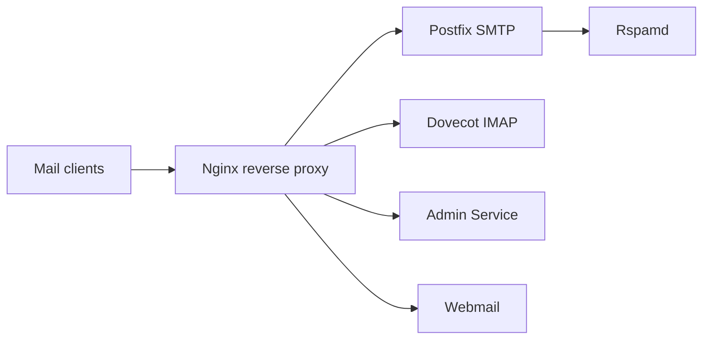

# Mailu/Mailu

> Serveur de messagerie complet distribué en images Docker, pour auto-hébergement.

## Le problème
Monter un serveur mail (SMTP, IMAP, antispam, webmail) à la main est long et fragile.

## Ce que ça fait vraiment
Ensemble de conteneurs : Nginx en frontal, Postfix (SMTP), Dovecot (IMAP), Rspamd (antispam), antivirus, DKIM, webmails et interface d'admin. Fonctions annoncées : alias, quotas, DANE, MTA-STS, Let's Encrypt, passkeys. Composants optionnels : Fetchmail, Radicale, Unbound.

## Comment c'est branché

## Essayer
Aucune commande dans le README : documentation et démo sur le site du projet.

## Coût et pièges
Gratuit, mais DNS, ports 25/143/993/587 et réputation IP sont à ta charge. Licence présente mais non identifiée par GitHub (le README dit MIT-compatible).

## Ce que ce n'est pas
Pas un groupware (agenda, collaboration) : le projet l'exclut. Pas un service géré.

## Alternatives
Aucune alternative nommée dans le README.

## Pour toi
À ignorer : administration de messagerie, hors data/IA ; vérifier la licence avant tout usage pro.

