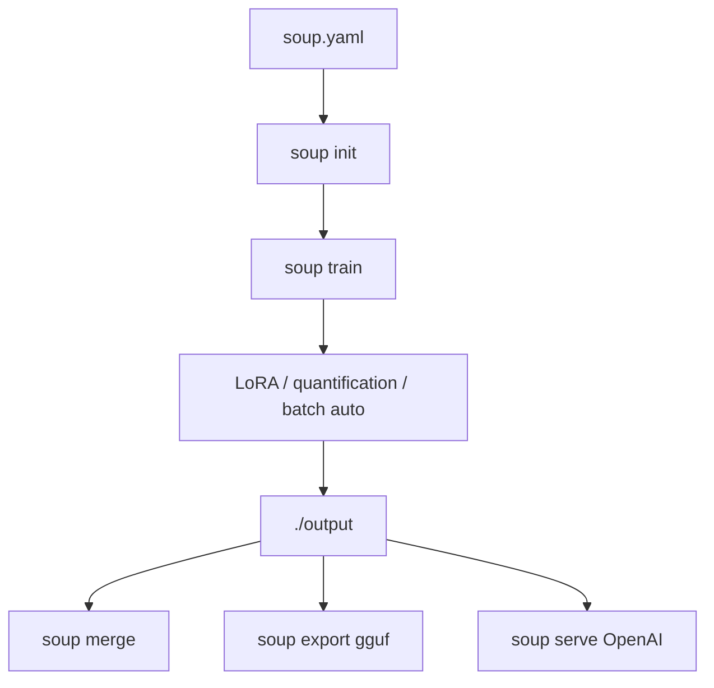

# MakazhanAlpamys/Soup

> CLI to fine-tune and post-train LLMs in one command, with a single YAML config.

## The problem
Fine-tuning an LLM remains painful: 30-50% of the time is spent fighting infrastructure (SSH, quantization, batch size, VRAM) rather than improving the model.

## What it actually does
One `soup.yaml` config, one `soup train` command: LoRA, quantization, GPU detection, automatic batch size. Layer streaming (opt-in, BETA) keeps the frozen base out of VRAM and streams it layer by layer — fine-tunes an 8B on a 4 GB GPU (measured 119.6 tok/s, 3.32 GB). SFT/DPO/GRPO/PPO/KTO/ORPO/SimPO tasks. transformers/MLX/Unsloth backends. GGUF/ONNX/AWQ export, OpenAI-compatible server, web UI, `soup doctor`.

## How it is wired


## Trying it
```bash
pipx install "soup-cli[train]"
soup init --template chat
soup train
```

## Cost and gotchas
Free. CUDA GPU recommended (8 GB+ for 7B QLoRA); CPU is experimental and very slow. Python 3.10-3.12 only. Since v0.75, an unknown config key **refuses** to load. Telemetry is opt-in. Layer streaming still BETA, 4 GB re-measurement pending.

## What it is not
Not a cloud service: training is local or in Docker. Not guaranteed on Python 3.13+.

## Alternatives
- Axolotl: cited as the reference for data pipeline parity.
- Unsloth: offered as a backend (2-5x faster), not as a substitute.

## For you
Very relevant if you fine-tune LLMs with little VRAM; layer streaming is the asset. Watch (single maintainer, young project).
