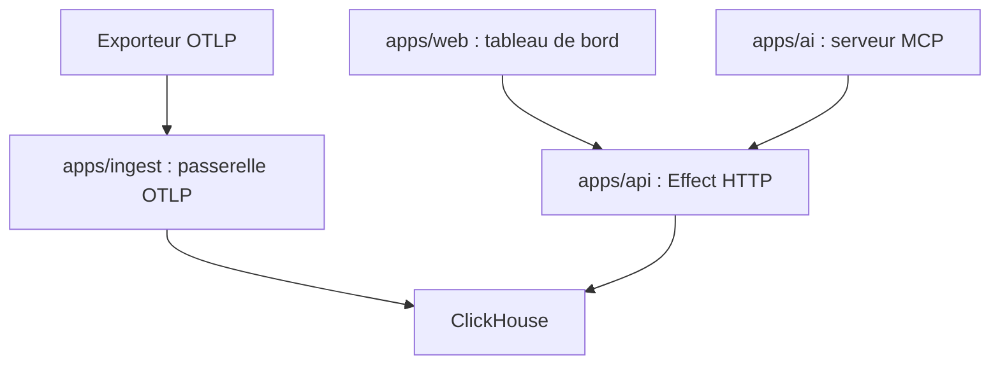

# Makisuo/maple

> Open-source observability platform (traces, logs, metrics) built on OpenTelemetry and ClickHouse.

## The problem
Observability tools require a proprietary agent or are expensive, and don't help coding agents read telemetry.

## What it actually does
Maple receives OTLP without a proprietary agent. It offers trace waterfalls, log search, a metrics explorer, a service map, error issues with alerts (PagerDuty, Discord, Telegram, email, webhook) and browser session replays. A hosted MCP server lets Claude Code or Cursor query the telemetry, and an agent runs investigations.

## How it is wired
Simplified diagram based on the sheet, no diagram provided.


## Trying it
```bash
brew install Makisuo/tap/maple
maple start
claude mcp add --transport http maple https://api.maple.dev/mcp
docker compose -f docker-compose.yml up --build
```

## Cost and gotchas
maple.dev is a hosted service; self-hosting requires Postgres, several secret variables and, in production, Cloudflare. Local mode is a single binary with embedded ClickHouse. The license is not identified by GitHub.

## What it is not
Not a simple collector: it is a whole stack of services. A breaking change on self-hosted authentication is documented (root password required). Young repository (February 2026).

## Alternatives
No alternative named in the README.

## For you
Worth watching: native OpenTelemetry and MCP suit MLOps well, but the unclear license and the project's youth call for a local trial first.
