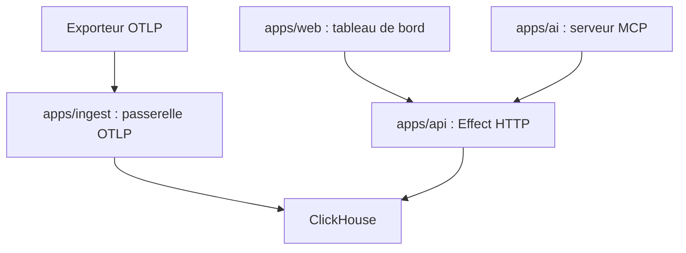

# Makisuo/maple

> Plateforme d'observabilité open source (traces, logs, métriques) sur OpenTelemetry et ClickHouse.

## Le problème
Les outils d'observabilité imposent un agent propriétaire ou coûtent cher, et n'aident pas les agents de code à lire la télémétrie.

## Ce que ça fait vraiment
Maple reçoit de l'OTLP sans agent propriétaire. Il offre cascades de traces, recherche de logs, explorateur de métriques, carte de services, issues d'erreurs avec alertes (PagerDuty, Discord, Telegram, e-mail, webhook) et replays de session navigateur. Un serveur MCP hébergé laisse Claude Code ou Cursor interroger la télémétrie, et un agent mène des investigations.

## Comment c'est branché
Schéma simplifié d'après la fiche, sans diagramme fourni.


## Essayer
```bash
brew install Makisuo/tap/maple
maple start
claude mcp add --transport http maple https://api.maple.dev/mcp
docker compose -f docker-compose.yml up --build
```

## Coût et pièges
maple.dev est un service hébergé ; l'auto-hébergement demande Postgres, plusieurs variables de secrets et, en production, Cloudflare. Le mode local est un binaire unique avec ClickHouse embarqué. La licence n'est pas identifiée par GitHub.

## Ce que ce n'est pas
Pas un simple collecteur : c'est toute une pile de services. Un changement cassant sur l'authentification auto-hébergée est documenté (mot de passe racine obligatoire). Dépôt jeune (février 2026).

## Alternatives
Aucune alternative nommée dans le README.

## Pour toi
À surveiller : OpenTelemetry natif et MCP conviennent bien au MLOps, mais licence floue et jeunesse du projet demandent un essai local d'abord.

