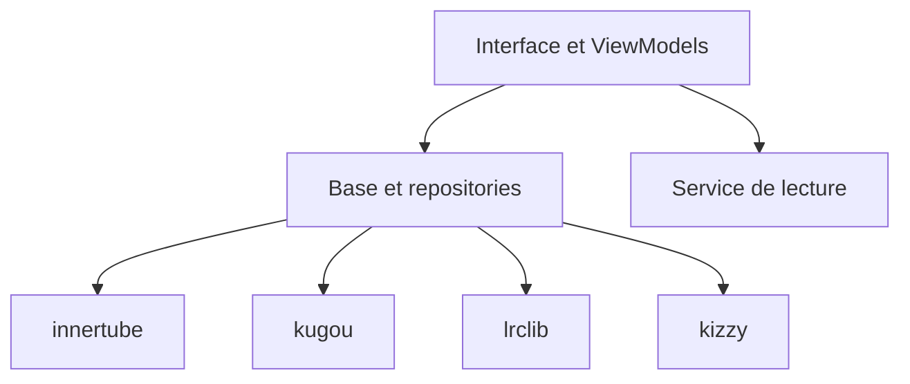

# Maloy-Android/Muzza

> Material 3 Android client for YouTube Music, with ad-free playback and synchronized lyrics.

## The problem
The official app imposes ads, a subscription and few settings for background listening.

## What it actually does
Multi-module Kotlin application. The InnerTube module talks to YouTube Music, Kugou and Lrclib provide lyrics, Kizzy handles Discord. Cache and offline download, Spotify import, crossfade, audio normalization, Android Auto.

## How it is wired

## Trying it
No command in the README: APKs are downloaded from the indicated Telegram channel.

## Cost and gotchas
Free. Depends on YouTube Music: unusable in an unsupported region without a proxy or VPN. Distributed via Telegram, outside the stores.

## What it is not
Not an official service: it bypasses YouTube Music's ad model, which may violate its terms. Nothing to do with data.

## Alternatives
No alternative cited in the README. The README thanks InnerTune, OuterTune, Metrolist and OpenTune, from which it takes inspiration.

## For you
Ignore: a hobby app outside your scope, relying on an unofficial third-party service.
